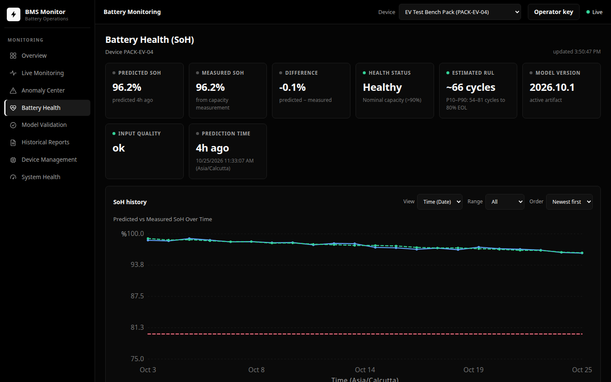
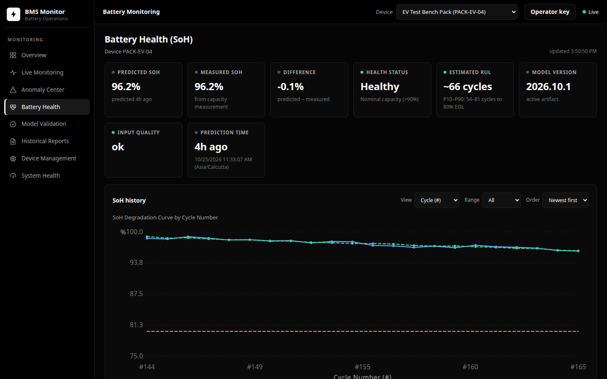
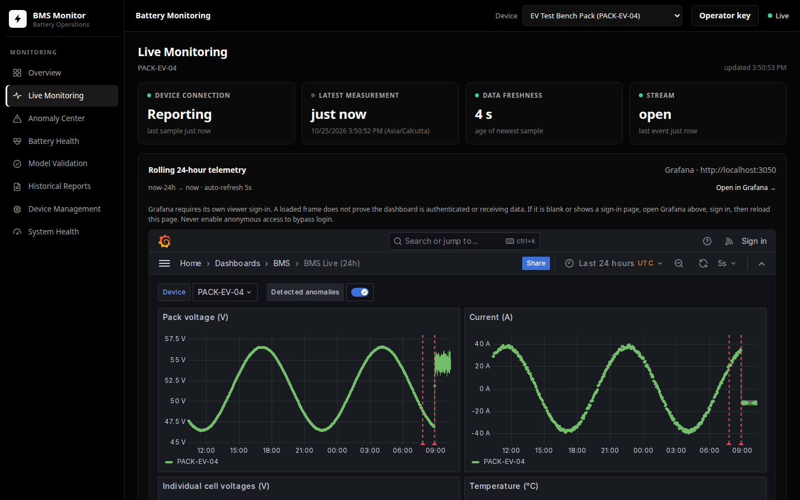
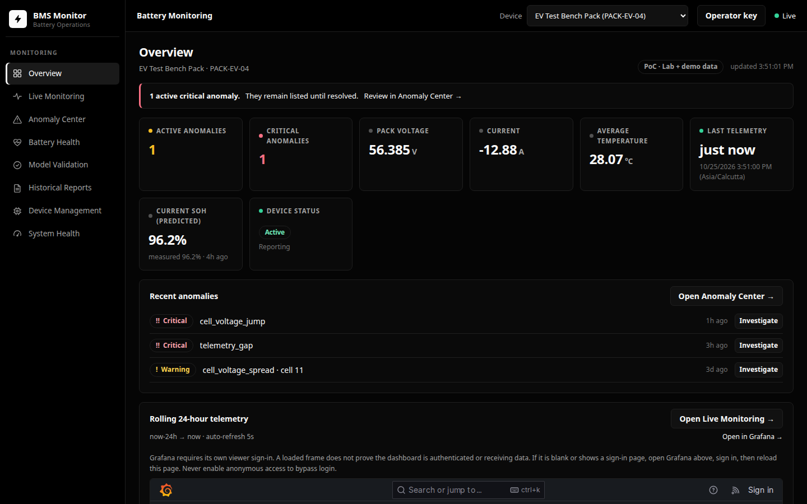
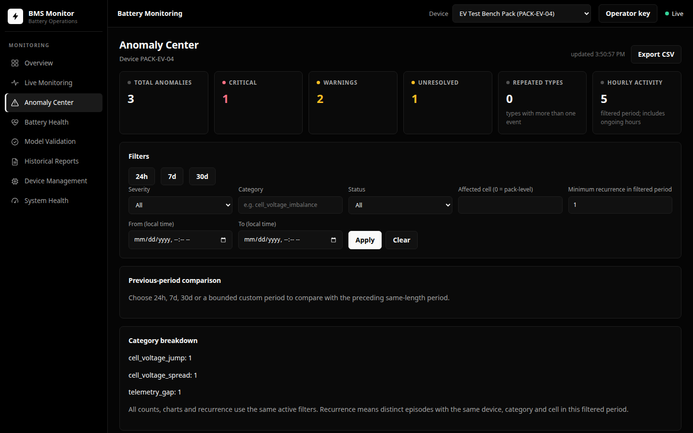
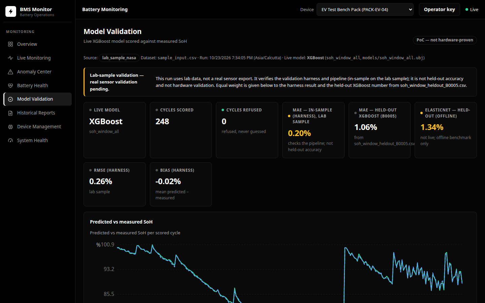
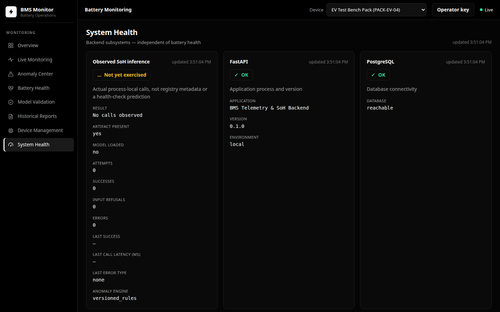

# SGE — Battery Predictive Maintenance System
> **Reproducibility:** All reported numbers are generated by committed scripts and written to `data/processed/*.csv`. `scripts/make_report.py` reads only those CSVs, never hardcodes values, and records every number it renders in `data/processed/report_numbers.json`. `scripts/check_numbers.py` re-renders the report regions from that JSON and fails on any difference or on any number that is not a rendered placeholder.

An end-to-end machine-learning pipeline and interactive monitoring dashboard for predicting the **State of Health (SOH)** and **Remaining Useful Life (RUL)** of lithium-ion batteries. Built on the NASA Battery Dataset, the system trains per-cell and global XGBoost models using a rigorous leave-one-cell-out cross-validation protocol and serves results through a FastAPI backend backed by PostgreSQL, with the React (Vite) dashboard in `frontend/` as the operator interface, MQTT telemetry ingestion, and Grafana provisioned alongside for the pack and offline-results views.



> **Two SOH regimes, and which one uses learning.** When a **full discharge** is measured, SOH is read directly from the capacity by Coulomb counting — that is a formula, not a model, and its error is measurement error, so no machine learning competes with it there. When only the **partial window** is available — what a BMS actually sees online — SOH is predicted by a cell-relative window model, and that partial-discharge task is the one place a model is compared against a physics formula (the window formula). The wider feature-set benchmark further down uses signals that exist only after a complete discharge, so it is an offline reference, not the online estimator.

---

### Known limits at a glance

| Limit | What it means |
|---|---|
| **9 of 19 cells kept** | The audit keeps nine cells (G1×4, G3×4, G9×1); ten are excluded for a raised SOH ceiling or a capacity that rises across the record. The re-reference check shows the exclusion is not a reference artifact. |
| **"Partial" does not mean small** | <!-- make_report:window_share -->The 4.0–3.4 V window is not a small slice: across the 9 kept cells it holds 56% of each discharge's capacity and 51% of its time on average (26–80% cell by cell; the cold G9 cell B0053 holds the least). Per cell in `docs/MODEL_CARD.md`.<!-- make_report:window_share:end --> |
| **RUL is indicative, and not only on G1** | Remaining-life labels need a cell that reaches 80% SOH. The four G1 cells do, so each is scored leave-one-cell-out over the other three trajectories, but four random-load cells (B0039, B0042, B0043, B0044) also reach 80% and are kept out of the model because their load and temperature change across the record. Two RUL methods disagree by 63.8 discharges on the mean, so every RUL number is reported as indicative, not a forecast. |
| **The window model transfers to the random-load cells it never saw** | The shipped partial-window SOH model is trained only on the nine constant-current cells, yet it beats the window formula on all four random-load cells the audit keeps, so their exclusion is a comparability choice, not a transfer failure (see *Random-load transfer* under Key Results). The caveat is B0039: its R² is below zero, so there the model reads the level, not the fade shape. |
| **Robust to sensor noise; a shorter window is not settled on every cell** | <!-- make_report:window_train -->With Gaussian noise on the held-out cell's inputs the pooled MAE stays under 3% up to 20 mV of voltage noise and 5% of current noise. A shorter window fails only when the 4.0–3.4 V model is handed a band it was not trained on, but judged on three held-out numbers at once — pooled MAE, random-load-only MAE and the worst single cell — no window of the 5 tried, the shipped band included, holds all three under 3%. Only 2 of 5 otherwise hold the random-load mean, and the shipped 4.0–3.4 V band's worst cell is 3.64% against 1.70% pooled (see *A model trained on its own window* under Key Results).<!-- make_report:window_train:end --> |
| **Alerts** | Grafana evaluates the rules itself through a Prometheus exporter and they fire on the injected fault; firing alerts are delivered to a provisioned local webhook contact point (`alert-sink` in the compose stack), so the notification path is exercised end to end. No external email/pager endpoint is configured. |
| **Model versus formula** | A full discharge is Coulomb counting (a formula, no model). The partial window is the only place a model is scored against the window formula; the full-feature SOH benchmark is offline and is not the online estimator. |

---

## What this is not

- **It is not our own packs.** Every number here is measured on laboratory
  NASA lithium-ion cells cycled under controlled constant-current and
  randomised-load profiles — never on the production packs this project
  targets, and never on a customer cell.
- **It has no field validation.** There is no deployment on a real battery,
  no comparison against a manufacturer's reference, and no hardware
  sign-off. The quality gates are smoke checks on a handful of lab cells,
  and the dashboard and MQTT path are exercised on injected faults, not on
  aged field data.
- **The RUL is indicative, not a forecast.** Remaining-life labels need a cell
  that reaches the end-of-life threshold; only a few cells do, and the two
  RUL methods disagree on the mean. Every remaining-life number is reported
  as a spread, not a prediction.

## What a real BMS must provide

To score a partial discharge, the model needs measurements it was actually
trained on. Each threshold below is read from `src/features.py`, so this list
cannot drift from the model's own contract:

<!-- make_report:bms_contract -->
- **A discharge that covers the trained window.** Every window feature is measured between `WINDOW_VOLTAGE_HIGH` = 4.0 V and `WINDOW_VOLTAGE_LOW` = 3.4 V in `src/features.py`. A window measured over a different span is refused, not scored.
- **At least 3 early discharges.** The cell-relative baseline is the median of the first 5 opening discharges, and a cell with fewer than 3 is refused because the baseline would be a guess.
- **Current near the training range, 2.0-4.0 A.** The kept cells discharge at 2.0 A (G1, G9) and 4.0 A (G3); the per-amp normalisation removes that rate difference inside the band, but the model has no training data far outside it.
<!-- make_report:bms_contract:end -->

Outside that contract there is no estimate: a window over a different voltage
span, or a cell with too few opening discharges, is refused rather than
guessed. `docs/CONTRACT.md` lists the full input set and its units.

---

## Live model, offline benchmarks, and PoC status

- **Live prediction: XGBoost only.** The backend estimator
  (`backend/app/ml/estimator.py`) loads `models/soh_window_all.ubj` —
  the cell-relative XGBoost partial-window model. That is the only
  model that produces a live SoH prediction.
- **ElasticNet is an offline benchmark only.** The
  XGBoost+ElasticNet blend and the standalone ElasticNet numbers in
  the tables below come from offline, full-feature experiments. They
  are **not deployed, not used in live prediction, and must not be
  described as a live improvement.**
- **This is a tested PoC, not a hardware-proven BMS.** All results so
  far are on NASA laboratory cells (see *What this is not* above).
  The current priority is validating the live XGBoost model on real
  sensor data with `scripts/validate_real_data.py` (report served at
  `GET /api/v1/validation/summary` and shown on the dashboard's Model
  Validation page); whether to improve or replace the model is a
  decision for after those real-data results.

## Results at a glance

The headline numbers, generated from the CSVs. The full tables and how to read them are in [`docs/RESULTS.md`](docs/RESULTS.md).

<!-- make_report:results_glance -->
| Task | Method | Protocol | Score | Baseline | Unit |
|---|---|---|---|---|---|
| SOH (offline, full features) | Coulomb formula | leave-one-cell-out (G1) | 0.73 | constant mean 9.28 | MAE % |
| SOH (offline, full features) | XGBoost+ElasticNet blend (nested) | nested leave-one-cell-out (G1) | 1.89 | constant mean 9.28 | MAE % |
| SOH (partial window) | Cell-relative XGBoost | train G1+G3, test B0053 | 2.99 | window formula 10.15 | MAE % |
| RUL | Trajectory model | leave-one-cell-out (G1) | 20.5 | fleet lifetime 34.3 | discharges |
<!-- make_report:results_glance:end -->

SOH is the partial-discharge (window-only) task — the only online SOH signal a BMS has; the full-discharge benchmark is a formula and is not the deployable estimator. Read the two “offline, full features” rows as offline benchmarks only: in particular the XGBoost+ElasticNet blend is not the live model and is not a live improvement — live prediction is the cell-relative XGBoost (`soh_window_all`) in the third row's family. RUL is indicative and reported as a range, not a point: the winner between the two methods depends on the cell and the reference group, so no single method is shipped.

---

## Documentation

- [`docs/RESULTS.md`](docs/RESULTS.md) — every measured result and its interpretation
- [`docs/SETUP.md`](docs/SETUP.md) — install, run, dashboard, live pack monitor, architecture
- [`docs/MODEL_CARD.md`](docs/MODEL_CARD.md) — inputs, held-out accuracy, conditions tested, refusal rules
- [`docs/OWN_CELL_PROTOCOL.md`](docs/OWN_CELL_PROTOCOL.md) — how to log your own 18650 cells for the pipeline
- [`docs/CONTRACT.md`](docs/CONTRACT.md) — generated backend and ML contract
- [`docs/RESEARCH.md`](docs/RESEARCH.md) — pack-monitoring findings and sources
- [`CHANGES.md`](CHANGES.md) — the overhaul log, step by step

---

## Known Limitations

These are limits of the data, not of the implementation, and no
amount of tuning removes them.

1. **Small cell count.** The SOH and RUL headline numbers come
   from the four NASA group-1 cells B0005, B0006, B0007 and B0018.
   In leave-one-cell-out validation that is three training
   trajectories per fold. The model therefore generalises across
   *these* trajectories, not across lithium-ion cells in general.

2. **Raw features do not transfer across conditions; the model
   needs cell-relative features and a baseline.** Trained on raw
   window features and tested on a held-out operating condition the
   model is useless (first table under *Key Results*). The groups
   differ in ambient temperature and current (G1 24 °C/2 A,
   G3 43 °C/4 A, G9 4 °C/2 A) so the raw levels do not line up.
   Per-cell baseline-relative window features fix the transfer, and
   the model then beats the window formula on the held-out
   condition. The remaining caveat is the baseline itself: it needs
   the cell's own opening discharges, and with only one or two the
   error is much larger (the reference-window table under *Key
   Results* shows the cost). The transfer is not limited to the
   single held-out condition: the shipped model, trained only on the
   nine constant-current cells, also beats the window formula on the
   four random-load cells it never saw (the random-load transfer
   table under *Key Results*), though on one of them its R² is below
   zero, so there it reads the level and not the fade.

3. **Cell-level generalisation is the open problem.** The headline
   is a mean over folds; the spread matters more than the mean.
   B0006 fails badly and for a diagnosable reason.

4. **B0006 cannot be predicted well by this feature set.** It
   degrades further than any cell the model trains on in its fold,
   so a tree ensemble averages toward its training floor. The
   per-cell error is in the Key Results table and the SOH range is
   in `cell_audit.csv`. This is a data-coverage limit: no
   hyperparameter setting invents a degradation the training cells
   never exhibited. It is reported, not hidden, and B0006 is not
   deleted to improve the score.

5. **RUL is indicative, and the two methods disagree.** Trajectory
   matching beats the fleet-lifetime baseline on the mean, but it
   loses on B0006 to the early-fade extrapolation. Neither method
   dominates, so no per-cell method is chosen: both are shown on
   every held-out cell and their disagreement (63.8 discharges on
   the mean, 107.1 on B0007) is reported as the uncertainty. That
   width is why RUL is labelled indicative rather than a forecast.
   Its interval is a reference spread, not a calibrated band, and
   on B0006 it is 0% — the whole spread sits above the truth.
   Calibrating a real 10th-to-90th band from the other cells does
   not work here either: it swings from 0% to 100% across held-out
   cells, because only three cells calibrate any band and a cell's
   residuals are correlated across discharges, so the effective
   calibration sample is closer to three than to the number of
   points. RUL also does not depend on G1 alone: the random-load
   cells B0039, B0042, B0043 and B0044 reach 80% and pass the same
   keep filter, and are not added to the training set because their
   load and temperature change across the record; the partial-window
   SOH model nonetheless transfers to them (the random-load transfer
   table under *Key Results*), so the exclusion is a comparability
   choice, not a transfer failure. With three training
   trajectories, the held-out cell's own future behaviour
   dominates. The usable RUL-family output is the per-cell fade rate
   plus the trajectory estimate, not a claim of uniform superiority.

6. **Streaming versus offline cycle index.** Offline `cycle` is
   the raw array index; streaming `cycle` is the discharge
   ordinal. The two differ. This is documented in
   `streaming/cycle_tracker.py` and pinned by tests, but it is a
   real train/serve skew, not a cosmetic one.

7. **The cell filter is conservative, not optimal.** Ten of the
   nineteen cells are excluded. The re-reference check in the
   degradation section shows that the gentler rule it started from
   rescues none of them, that the four G7 cells look usable except
   for a high first cycle, and that no G4 cell can be rescued at any
   reference because its capacity genuinely rises. Returning G7 would
   need a beginning-of-life-peak reference applied uniformly (which
   rescales every kept cell's SOH) or a per-cell fallback (which
   makes the reference depend on the outcome it is tested against).
   Neither was adopted, so the project keeps nine cells and reports
   the finding rather than quietly widening the dataset.

8. **One cycle-latency contract.** SOH is emitted once per
   completed discharge, not per sample, because several features
   are only defined at cycle end.

9. **The window model is robust to sensor noise; a shorter
   window is not settled on every cell.** Adding Gaussian noise to a
   held-out cell's voltage and current barely moves the pooled
   held-out MAE: it stays under 3% up to 20 mV of voltage noise and
   5% of current noise. Feeding a narrower band to the 4.0–3.4 V
   model fails, but that is a mismatch between training and
   inference, not the window length: train a model on the band and
   the pooled mean holds (every band tried stays under 3%), but
   judged on three held-out numbers at once — pooled MAE,
   random-load-only MAE and the worst single cell — no band, the
   shipped 4.0–3.4 V band included, holds all three under budget. So
   the stable claims are the noise robustness and the pooled mean;
   the window-length question is not settled on every cell (the
   window-trained table under *Key Results*).

Accuracy is stated as measured, per cell and per held-out condition,
in the tables in [`docs/RESULTS.md`](docs/RESULTS.md); it is not a
production accuracy claim.

---

## Run the dashboard (demo)

The whole stack runs from the root `docker-compose.yml`:

```bash
docker compose up --build -d                       # the whole stack
```

On first boot the `demo-seed` service waits for `bms-api` to migrate the
schema, then loads the demo fleet automatically — a first run therefore
opens on a populated dashboard. It seeds **only when the database is
empty** (`scripts/seed_if_empty.py`), so restarting the stack never
wipes data. Then open:

- **Dashboard:** http://localhost:5173 — the React app, served by nginx
  (the compose `frontend` service), which proxies `/api` to the backend,
  so the browser only needs this one origin.
- **API:** http://localhost:8000 — the FastAPI backend (`bms-api`);
  interactive docs at http://localhost:8000/docs.
- **Grafana:** http://localhost:3050 — the provisioned dashboards that
  ship alongside the React app; the admin password is
  `GRAFANA_ADMIN_PASSWORD` (default `admin`, change it).

The seed loads four named demo packs with 24 h of telemetry, cycles,
SoH predictions and an anomaly history into Postgres. To reset the demo
data deliberately, run `scripts/seed_demo_data.py` itself against the
database — unlike the seed-if-empty wrapper it **truncates every data
table first**, so run it only against a throwaway database. The compose stack
also runs `telemetry-simulator` to stream continuous 1 Hz live telemetry for
the demo fleet so the Live Monitoring dashboard stays live in real time. The `demo`
profile additionally provides `demo-publisher`, a synthetic MQTT replay with
injected faults that stands in for the ESP32.

Without Docker (host path): create the schema with
`alembic upgrade head` (from `backend/`), run
`python scripts/seed_if_empty.py`, start the backend
(`uvicorn app.main:app --port 8000`), then the frontend
(`npm run dev` in `frontend/`, or `npm run build` and serve `dist/`
behind the `frontend/nginx.conf` proxy). See `backend/README.md` and
`frontend/README.md` for details.

---

## Dashboard Tour & User Interface

The React operator interface (`frontend/`) provides 8 specialized operational views for battery analytics:

### 1. Battery Health (SoH & RUL)
State-of-Health prediction and Remaining-Useful-Life estimation:
- **Predicted vs. Measured SoH**: Compares the live partial-window XGBoost model prediction with Coulomb-counted capacity measurements.
- **Estimated RUL with P10–P90 Confidence Bounds**: Displays median estimated discharges to 80% EOL alongside 10th and 90th percentile bounds derived from empirical degradation trajectory matching.
- **Health Status Indicator**: Automated status grading (`Healthy` for >90%, `Aging` for 80%–90%, and `Degraded (EOL)` for <80% nominal capacity).
- **80% EOL Reference Threshold**: Industry-standard 80.0% End-of-Life dashed reference line to immediately gauge distance to replacement.
- **Dual View Modes**:
  - **Time (Date)**: Groups degradation across calendar timelines with smart multi-day date tick formatting.
  - **Cycle (#)**: Displays degradation strictly indexed by cycle number.


*Figure 1: Battery Health page in Time (Date) view showing multi-week degradation curve and 80% EOL threshold.*


*Figure 2: Battery Health page in Cycle (#) view showing discrete discharge cycles.*

### 2. Live Telemetry & Streaming
Real-time 1 Hz streaming telemetry ingested via MQTT and SSE:
- Sub-second freshness indicators and connection health.
- Live 24-hour rolling Grafana embed with pack voltage, individual cell voltages, current waveforms, and thermal gradients.
- Automated anomaly marker flags aligned directly with telemetry events.


*Figure 3: Live Monitoring interface with 1 Hz continuous telemetry and rolling Grafana visualizer.*

### 3. Fleet Overview
High-level operational summary of all registered battery packs:
- Fleet-wide active anomaly counters, healthy pack ratios, and quick pack selection.
- High-density Grafana time-series monitoring for rapid fleet diagnosis.


*Figure 4: Fleet Overview dashboard with aggregated KPIs and high-density Grafana telemetry.*

### 4. Anomaly Center & Fault Triage
Automated anomaly detection powered by an Isolation Forest model and deterministic safety rules:
- Detects cell voltage spread, overtemperature, overcurrent, and rapid voltage drop anomalies.
- Full incident workflow with audit trail (`open` → `acknowledged` → `investigating` → `resolved`).
- Multi-dimensional filters (time range, severity, category, cell) and instant CSV export.


*Figure 5: Anomaly Center incident management console.*

### 5. Model Validation & Benchmark Harness
Live performance tracking of the production XGBoost model:
- Real-time Mean Absolute Error (MAE), Root Mean Squared Error (RMSE), and bias metrics.
- Side-by-side comparison between the live XGBoost model and offline ElasticNet benchmarks.
- Held-out validation curve ensuring no model drift or extrapolation hallucinations.


*Figure 6: Model Validation interface tracking prediction accuracy and error distributions.*

### 6. System & Inference Health
Operational telemetry for the backend services and ML inference runtime:
- Tracks live model inference calls, latency (in ms), success rates, and input refusal events.
- Database connectivity status for PostgreSQL and FastAPI process metrics.


*Figure 7: System Health and live inference runtime telemetry.*

---

## Authentication & Operator Key

The dashboard includes role-based access control for administrative actions:
- **Viewer Access**: Read-only monitoring of all metrics, charts, and telemetry.
- **Operator Access**: Enables write operations, including:
  - Acknowledging and resolving anomaly incidents.
  - Quarantining packs or overriding device parameters.
  - Triggering manual cycle re-aggregation and SoH refreshes.

**How the Operator Key works:**
1. In the `bms-api` service environment (`docker-compose.yml` or `.env`), define `BMS_OPERATOR_API_KEY`:
   ```bash
   BMS_OPERATOR_API_KEY=your-secret-operator-key
   ```
   *(When left unset, operator authentication defaults to local development mode and actions are permitted without a key).*
2. In the dashboard top navigation bar, click the **Operator key** button.
3. Enter your configured key. It is saved in the browser tab's `sessionStorage` and sent via the `X-Operator-Key` HTTP header on write requests.
4. For read-only protection across the entire dashboard, set `BMS_VIEWER_API_KEY` (sent via `X-Viewer-Key`).

---

## How to run verify

`scripts/verify.sh` clones the committed repository into a temporary directory, downloads and checksums the NASA dataset, runs the pipeline with `--skip-train`, runs the full test suite (and the backend partial-window estimator tests), then checks that every number in the generated documents is a placeholder rendered from `data/processed/report_numbers.json`. It exits non-zero on any failure.

```bash
bash scripts/verify.sh
```

The same gate runs in GitHub Actions as the **Verify BMS** workflow
(`.github/workflows/verify.yml`) on every push and pull request: lint
(Ruff), root ML tests, the backend suite against a dedicated test
database, frontend unit tests + typecheck + build, a Playwright
browser suite (28 end-to-end tests against the production build), and
a compose smoke test. A `merge-gate` job aggregates them into a
single status that reports success only if every job passed (see
`CONTRIBUTING.md`). `verify.sh` is the local equivalent; it needs
Docker (throwaway Postgres) and network access for the dataset
download.

To run the pipeline directly instead:

```bash
python run_pipeline.py --skip-train   # keep the committed models
python run_pipeline.py                # all stages, including training
```

---

## License

This project is for academic and research purposes.
