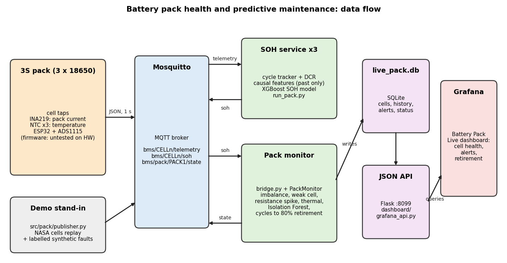
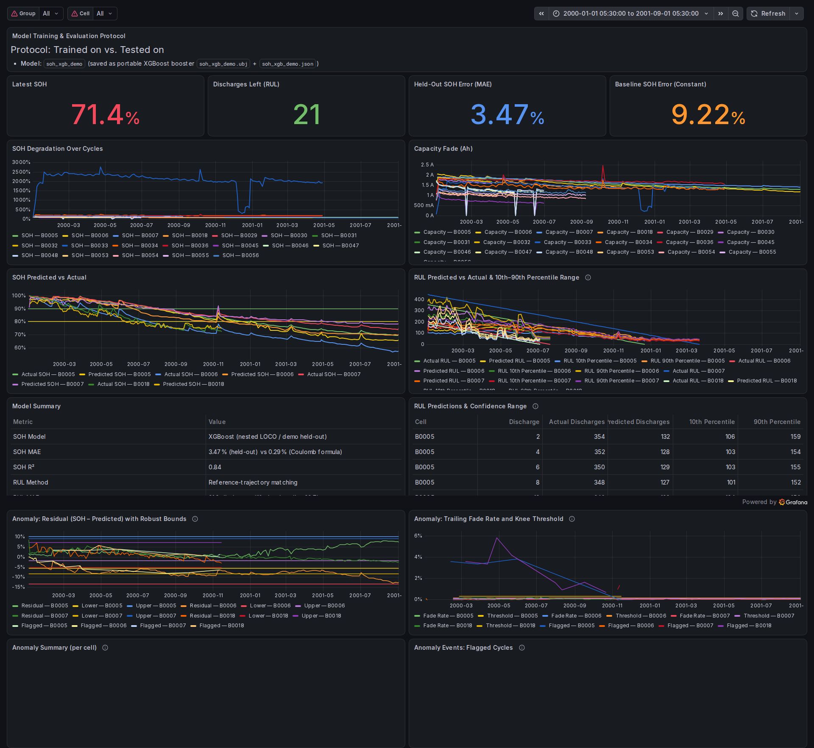
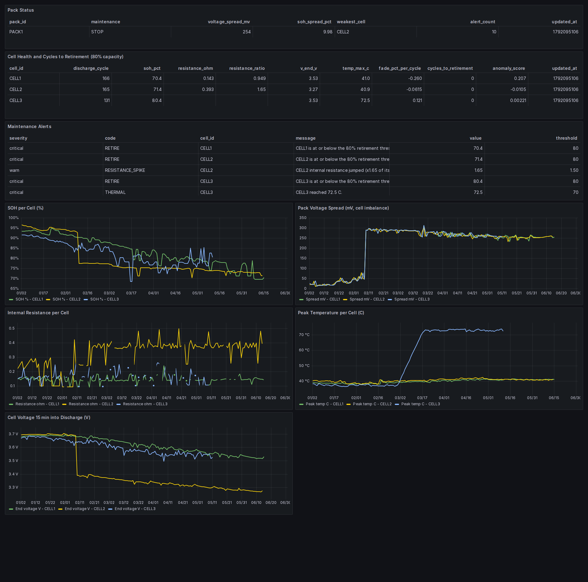

# SGE — Battery Predictive Maintenance System
> **Reproducibility:** All reported numbers are generated by committed scripts and written to `data/processed/*.csv`. `scripts/make_report.py` reads only those CSVs, never hardcodes values, and records every number it renders in `data/processed/report_numbers.json`. `scripts/check_numbers.py` re-renders the report regions from that JSON and fails on any difference or on any number that is not a rendered placeholder.

An end-to-end machine-learning pipeline and interactive monitoring dashboard for predicting the **State of Health (SOH)** and **Remaining Useful Life (RUL)** of lithium-ion batteries. Built on the NASA Battery Dataset, the system trains per-cell and global XGBoost models using a rigorous leave-one-cell-out cross-validation protocol and serves results through a native **Grafana** dashboard backed by a custom Flask JSON API and SQLite database.

> **Two SOH regimes, and which one uses learning.** When a **full discharge** is measured, SOH is read directly from the capacity by Coulomb counting — that is a formula, not a model, and its error is measurement error, so no machine learning competes with it there. When only the **partial window** is available — what a BMS actually sees online — SOH is predicted by a cell-relative window model, and that partial-discharge task is the one place a model is compared against a physics formula (the window formula). The wider feature-set benchmark further down uses signals that exist only after a complete discharge, so it is an offline reference, not the online estimator.

### Known limits at a glance

| Limit | What it means |
|---|---|
| **9 of 19 cells kept** | The audit keeps nine cells (G1×4, G3×4, G9×1); ten are excluded for a raised SOH ceiling or a capacity that rises across the record. The re-reference check shows the exclusion is not a reference artifact. |
| **RUL is indicative, and not only on G1** | Remaining-life labels need a cell that reaches 80% SOH. The four G1 cells do, so each is scored leave-one-cell-out over the other three trajectories, but four random-load cells (B0039, B0042, B0043, B0044) also reach 80% and are kept out of the model only because their load and temperature change across the record. Two RUL methods disagree by 63.8 discharges on the mean, so every RUL number is reported as indicative, not a forecast. |
| **Alerts** | Grafana evaluates the rules itself through a Prometheus exporter and they fire on the injected fault; firing alerts are delivered to a provisioned local webhook contact point (`alert-sink` in the compose stack), so the notification path is exercised end to end. No external email/pager endpoint is configured. |
| **Model versus formula** | A full discharge is Coulomb counting (a formula, no model). The partial window is the only place a model is scored against the window formula; the full-feature SOH benchmark is offline and is not the online estimator. |

---

## Table of Contents

- [Key Results](#key-results)
- [Known Limits at a Glance](#known-limits-at-a-glance)
- [Architecture](#architecture)
- [Project Structure](#project-structure)
- [Setup & Installation](#setup--installation)
- [Usage / Workflow](#usage--workflow)
- [Dashboard](#dashboard)
- [Dataset](#dataset)
- [Model Details](#model-details)
- [Technologies](#technologies)

---

## Key Results

Every number in the regions below is a `{{id}}` placeholder rendered by `scripts/make_report.py` from `data/processed/report_numbers.json`, which the same script writes from the CSVs under `data/processed/`. `scripts/check_numbers.py` re-renders these regions from that JSON, so a hand-typed number fails verification.

### SOH Prediction (State of Health)

<!-- make_report:results -->
#### Cross-condition transfer (leave-one-group-out, partial window only)

**On the partial-discharge task the model does not transfer across conditions when it is trained on raw window features.** A BMS that only watches the partial-discharge window never sees the full discharge, so this is the honest version of the SOH question: predict SOH from the window alone.
With the full feature set, leave-one-cell-out within G1 the same ElasticNet model reaches 1.81% MAE; held out across conditions on raw window features it climbs to as much as 42.66%. The table below is that failure, measured, not a model claim.

| Held-out group | Cells | Cycles | ElasticNet MAE (%) | XGBoost MAE (%) |
|---|---|---|---|---|
| G1 | 4 | 636 | 42.66 | 14.96 |
| G3 | 4 | 160 | 16.29 | 18.75 |
| B0053 (G9) | 1 | 55 | 7.47 | 6.69 |

**Cell-relative window features recover the transfer, and the model then beats the window formula on the held-out condition.** Because the groups differ in ambient temperature (G1 24 °C, G3 43 °C, G9 4 °C) and current (G1 2 A, G3 4 A, G9 2 A), the raw levels do not line up. Dividing each window quantity by the cell's own first-five-discharge median and by its current puts every cell on the same scale and makes the ElasticNet transfer to a condition it has never seen. The window formula — the window's amp-hours over that same per-cell median — is the best a BMS can do from the window alone, so it is scored on exactly the held-out cells for comparison.

| Held-out group | Cells | Cycles | window formula MAE (%) | raw ElasticNet MAE (%) | cell-relative ElasticNet MAE (%) | cell-relative XGBoost MAE (%) |
|---|---|---|---|---|---|---|
| G1 | 4 | 636 | 10.92 | 42.66 | 4.58 | 9.38 |
| G3 | 4 | 160 | 2.13 | 16.29 | 1.60 | 1.07 |
| B0053 (G9) | 1 | 55 | 10.15 | 7.47 | 3.42 | 2.99 |

B0053 is the only G9 cell the audit keeps, so its row is that cell alone, never averaged into a group. Reading it: the cell-relative ElasticNet error on B0053 is 3.42% against the window formula's 10.15%, and the cell-relative XGBoost error is 2.99% — both beat the formula on a condition the model has never seen. On the two multi-cell groups the model also beats it cell-by-cell (G1 ElasticNet 4.58% versus 10.92%, G3 ElasticNet 1.60% versus 2.13%), though XGBoost is weaker on G1. The cell-by-cell partial-discharge section below reports the same task with leave-one-cell-out validation.


#### Partial-discharge SOH, cell by cell (window only)

The same task, scored one held-out cell at a time: leave-one-cell-out within G1 and within G3, then train on every G1 and G3 cell and test on B0053, a condition the model has never seen. The window formula is scored on exactly the held-out rows.

| Protocol | Held-out cell | Cycles | window formula MAE (%) | ElasticNet MAE (%) | XGBoost MAE (%) |
|---|---|---|---|---|---|
| leave-one-cell-out: G1 | B0005 | 168 | 8.91 | 1.34 | 1.06 |
| leave-one-cell-out: G1 | B0006 | 168 | 18.82 | 2.51 | 3.31 |
| leave-one-cell-out: G1 | B0007 | 168 | 6.29 | 1.17 | 0.88 |
| leave-one-cell-out: G1 | B0018 | 132 | 9.32 | 1.70 | 0.89 |
| **leave-one-cell-out: G1 — mean** | — | — | 10.83 | 1.68 | 1.53 |
| leave-one-cell-out: G3 | B0029 | 40 | 1.94 | 0.74 | 0.69 |
| leave-one-cell-out: G3 | B0030 | 40 | 1.11 | 1.43 | 1.29 |
| leave-one-cell-out: G3 | B0031 | 40 | 1.06 | 0.80 | 0.65 |
| leave-one-cell-out: G3 | B0032 | 40 | 4.40 | 4.15 | 1.64 |
| **leave-one-cell-out: G3 — mean** | — | — | 2.13 | 1.78 | 1.07 |
| Train G1+G3, test B0053 | B0053 | 55 | 10.15 | 3.42 | 2.99 |
| **Train G1+G3, test B0053 — mean** | — | — | 10.15 | 3.42 | 2.99 |

#### Reference-window sensitivity (partial-discharge)

The cell-relative features need a baseline from the cell's own first `n` discharges; a new cell may have very few. Rebuilding the baseline for one, two, three and five opening discharges and re-running the task:


**Leave-one-cell-out (G1+G3)**

| Discharges used as baseline | window formula MAE (%) | ElasticNet MAE (%) | XGBoost MAE (%) |
|---|---|---|---|
| 1 | 15.16 | 1.46 | 1.82 |
| 2 | 9.14 | 1.31 | 1.47 |
| 3 | 6.59 | 1.60 | 1.26 |
| 5 | 6.48 | 1.73 | 1.30 |

**Train G1+G3, test B0053**

| Discharges used as baseline | window formula MAE (%) | ElasticNet MAE (%) | XGBoost MAE (%) |
|---|---|---|---|
| 1 | 78.57 | 22.09 | 4.01 |
| 2 | 20.98 | 7.16 | 4.05 |
| 3 | 9.50 | 2.83 | 2.74 |
| 5 | 10.15 | 3.42 | 2.99 |

Inside a group the picture is mixed: the plain window formula is sensitive to the baseline length, while the learned models stay flat because the held-out cell is trained on siblings at the same condition. The cross-condition transfer to B0053 is where the baseline length matters for the model too: one or two opening discharges set the scale too coarsely and the error spikes, and from three discharges it settles near its floor. The practical reading: give a new cell a few discharges before trusting its cell-relative SOH.


#### Offline SOH benchmark (full feature set)

This benchmark is deliberately offline: it uses every production feature, including full-discharge signals such as duration and resistance that a BMS only observes once the discharge has finished. It is a model-to-model reference; the online task, and the only place a model is compared against a physics formula, is the partial-discharge section above. The full-discharge Coulomb row is the formula that would be used when a complete discharge is available.

| Method | Validation | Mean MAE (%) | Mean R² |
|---|---|---|---|
| Coulomb formula | leave-one-cell-out (G1) | 0.73 | 0.993 |
| ElasticNet (default) | leave-one-cell-out (G1) | 1.81 | 0.948 |
| Ridge (default) | leave-one-cell-out (G1) | 2.70 | 0.908 |
| RandomForest (default) | leave-one-cell-out (G1) | 2.52 | 0.899 |
| XGBoost (fixed params) | leave-one-cell-out (G1) | 2.74 | 0.894 |
| XGBoost (nested tuning) | nested leave-one-cell-out (G1) | 2.65 | 0.900 |
| Constant global mean | leave-one-cell-out (G1) | 9.28 | — |

#### Per-cell SOH error (XGBoost, nested)

| Held-out cell | MAE (%) | RMSE (%) | R² |
|---|---|---|---|
| B0005 | 1.47 | 1.76 | 0.971 |
| B0006 | 5.62 | 6.23 | 0.751 |
| B0007 | 1.54 | 1.82 | 0.954 |
| B0018 | 1.96 | 2.30 | 0.925 |

#### Full- versus partial-discharge formulas (no model)

When the full discharge is available, SOH is read directly from the measured capacity by Coulomb counting and no model is used; the error is the formula's, not a prediction's. When only the window is available the same kind of formula is much weaker, which is exactly why the partial-discharge models above exist.

| Method | Held-out cell | MAE (%) |
|---|---|---|
| Full-discharge formula | B0005 | 0.17 |
| Full-discharge formula | B0006 | 0.53 |
| Full-discharge formula | B0007 | 0.28 |
| Full-discharge formula | B0018 | 0.18 |
| Full-discharge formula | mean (G1) | 0.29 |
| Partial-window formula | B0005 | 8.91 |
| Partial-window formula | B0006 | 18.82 |
| Partial-window formula | B0007 | 6.29 |
| Partial-window formula | B0018 | 9.32 |
| Partial-window formula | mean (G1) | 10.83 |

#### Feature-set ablation (XGBoost/ElasticNet, leave-one-cell-out on G1)

| Feature set | Features | ElasticNet MAE (%) | XGBoost MAE (%) |
|---|---|---|---|
| A — all production features | 39 | 1.81 | 2.74 |
| B — A without window features | 34 | 3.85 | 3.06 |
| C — window + temperature + current | 13 | 1.68 | 2.19 |
| D — window features only | 5 | 1.86 | 2.57 |
<!-- make_report:results:end -->

### RUL Prediction (Remaining Useful Life, Indicative)

<!-- make_report:rul -->
> **Indicative, not a forecast.** Every remaining-life number here is an estimate from a handful of reference trajectories under one load. It says where a cell sits on the average ageing path, not what will happen to that particular cell.

| Held-out cell | EOL discharge | Trajectory MAE | Fleet-lifetime baseline MAE | Reference-spread coverage | Mean reference-spread width |
|---|---|---|---|---|---|
| B0005 | 106 | 7.1 | 24.8 | 93.8% | 25.8 |
| B0006 | 60 | 51.1 | 46.0 | 0.0% | 25.5 |
| B0007 | 124 | 17.5 | 37.5 | 17.5% | 14.6 |
| B0018 | 77 | 6.5 | 29.0 | 82.1% | 20.3 |
| **Mean** | — | 20.5 | 34.3 | 48.3% | 21.6 |

#### Both methods, side by side on every held-out cell

The matcher was also scored against a fade-rate extrapolation: a straight line through the first 20 measured SOH values of the cell, extended to the retirement threshold. Both are leave-one-cell-out and use the same held-out discharges, so the columns are comparable. The last numeric column is the mean absolute gap between the two methods over those discharges.

| Held-out cell | Trajectory MAE | Early-fade extrapolation MAE | Method disagreement | Fleet-lifetime baseline MAE |
|---|---|---|---|---|
| B0005 | 7.1 | 76.9 | 81.4 | 24.8 |
| B0006 | 51.1 | 8.0 | 59.1 | 46.0 |
| B0007 | 17.5 | 90.8 | 107.1 | 37.5 |
| B0018 | 6.5 | 8.2 | 7.5 | 29.0 |
| **Mean** | 20.5 | 46.0 | 63.8 | 34.3 |

No method is chosen per cell, and no cell is scored with the method that happens to win it: that would be reading the answer off the test set. Instead both methods are shown on every held-out cell and their disagreement is reported as the uncertainty. It is large — 63.8 discharges on the mean, and 107.1 on B0007 — because a line that overshoots a late knee and a matcher that follows reference curves can disagree by an entire lifetime. That width, not a point estimate, is the honest statement about RUL on four cells, and it is why the whole task is labelled indicative.

#### Calibrating a real 10th-to-90th band

The reference-spread band above is a quantile of the reference cells' remaining life, not a calibrated error band. The honest version calibrates the band on the other cells and measures it on a cell it never saw: for each held-out cell the offsets are the 10th and 90th percentile of the (truth - estimate) residuals pooled from the other three cells.

| Held-out cell | Max points | Calibration cells | Lower offset | Upper offset | Coverage |
|---|---|---|---|---|---|
| B0005 | 96 | 3 | -51.0 | 27.0 | 100.0% |
| B0006 | 50 | 3 | -6.0 | 25.0 | 0.0% |
| B0007 | 114 | 3 | -52.0 | 10.0 | 28.1% |
| B0018 | 67 | 3 | -50.0 | 25.0 | 100.0% |
| **Mean** | — | — | — | — | 57.0% |

A 10th-to-90th band should cover four discharges in five, and this one misses by a wide margin and swings from 0.0% to 100.0% across cells. It is not fixable here: only three cells calibrate any held-out band, and one cell's residuals are correlated across its discharges, so the effective calibration sample is closer to three than to the number of points. A trustworthy calibrated band needs more cells than the four in G1; the reference spread remains the only band this dataset supports.

#### More cells that reach 80%? Yes, in the random-load groups

RUL needs a cell that actually reaches the retirement threshold, so the groups the model leaves out were checked against the same SOH rule rather than assumed dead. The NASA random-load groups G5 (B0038-B0040) and G6 (B0041-B0044) were run through it: 7 cells checked, 5 reach 80%, and 4 of those also pass the same ceiling/rise keep filter (B0039, B0042, B0043, B0044). So the claim that only the four G1 cells reach 80% is false in general: four more cells do. They are still not added to the model, because their load and temperature change across the record, so their features are not comparable at a single operating condition — the reason they were left out is comparability, not ageing. B0041 reaches 80% too but is excluded, because the very-low-capacity runs the dataset's own notes flag corrupt its early reference capacity, so its SOH never has a trustworthy baseline.
<!-- make_report:rul:end -->

> **Unit:** All RUL targets and predictions are measured in **sequential discharges** (`discharge_index`), not raw interleaved cycle numbers.

> **The interval is a reference spread, not a calibrated band.** The `rul_p10`/`rul_p90` values are the 10th and 90th percentiles of the remaining-life estimates produced by the *reference cells* a curve is matched against, so they say how much the answer depends on which reference you match — nothing more. The column above reports the empirical coverage of that spread against the real remaining life: it is 48.3% on average, not the ~80% a "10th–90th" label would imply. B0006 is the worst case at 0.0%: it fades faster than every reference cell (0.309 %/discharge, the steepest of the four) and retires far sooner, so the matcher, reading its remaining life off reference curves that aged more slowly, over-predicts what is left and the true value lands below the low end of the spread at every point. That is a limitation of matching one cell against reference curves that retired later, and it is reported rather than hidden.

### Battery Degradation Characteristics

<!-- make_report:degradation -->
| Cell | EOL discharge | Fade (%/discharge) | Early fade (%/discharge) |
|---|---|---|---|
| B0005 | 107 | 0.214 | 0.058 |
| B0006 | 61 | 0.309 | 0.284 |
| B0007 | 125 | 0.188 | 0.067 |
| B0018 | 78 | 0.248 | 0.319 |
| B0029 | — | 0.281 | 0.281 |
| B0030 | — | 0.279 | 0.279 |
| B0031 | — | 0.176 | 0.176 |
| B0032 | — | 0.286 | 0.286 |
| B0053 | — | 0.125 | 0.267 |

#### Re-referencing the excluded cells

Every SOH above is measured against the median of the cell's first five valid discharges. A gentler re-reference was checked on the excluded cells: the median of discharges 3-8, and the beginning-of-life peak (the maximum of the first five). The SOH ceiling and the capacity-rise test are held fixed, so a cell is returned only when the reference, not the rule, was what excluded it.

| Excluded cell | Group | first five median soh_max | median 3-8 soh_max | BOL-peak soh_max | Returned? |
|---|---|---|---|---|---|
| B0033 | G4 | 146.3 | 128.2 | 142.6 | no |
| B0034 | G4 | 112.3 | 118.1 | 109.5 | no |
| B0036 | G4 | 135.7 | 136.1 | 135.4 | no |
| B0045 | G7 | 122.2 | 129.9 | 100.0 | yes (BOL peak) |
| B0046 | G7 | 115.0 | 118.0 | 100.0 | yes (BOL peak) |
| B0047 | G7 | 111.0 | 114.8 | 100.0 | yes (BOL peak) |
| B0048 | G7 | 110.6 | 113.8 | 100.0 | yes (BOL peak) |
| B0054 | G9 | 106.4 | 109.0 | 100.0 | no |
| B0055 | G9 | 105.0 | 109.3 | 100.0 | no |
| B0056 | G9 | 103.6 | 105.7 | 100.0 | no |

The gentler rule the check started from returns nothing: none of B0054, B0055 or B0056 comes back. Their capacity genuinely rises from the recorded first discharge, so the drift is in the data, not only in the reference; B0054 also stays above the ceiling. The four G7 cells return under the beginning-of-life peak alone, because their reading above the 105% ceiling was a high first cycle sitting above the early median rather than a real rise. No G4 cell returns under any rule: its capacity rises across the record by far more than a reference choice can explain.

The peak reference is reported and not adopted: applying it uniformly would rescale every kept cell's SOH, and a per-cell fallback would make the reference depend on the outcome it is tested against. The production reference is unchanged, so no kept cell's SOH and no reported number moves.
<!-- make_report:degradation:end -->

---

## SOH Definition

SOH is defined explicitly and in exactly one place, per cell:

```
SOH = capacity_ah / reference_capacity_ah x 100
```

`reference_capacity_ah` is the **median measured discharge
capacity of that cell's first five valid discharges**
(`src/data_cleaning.py`). A discharge is *valid* when its measured
capacity is greater than zero and at least half the cell's median
capacity; invalid rows (sensor dropouts, near-zero integrations)
are dropped before the reference is taken. The reference is
deliberately per-cell, not a chemistry-level nominal capacity,
because the NASA cells differ in their beginning-of-life capacity.
Every value in the `soh` column is computed from that one rule.

Consequences of this policy, stated plainly:

- SOH is approximately, not exactly, 100% at the reference
  discharges, because the reference is a median rather than a
  single cycle.
- SOH is only comparable *within* a cell, since two cells with
  different reference capacities share a scale but not an absolute
  reference.
- A cell that was already partly aged when first measured would
  read below 100% at that point.

The target is **not clipped**. `data/processed/cell_audit.csv`
records each cell's `soh_min` and `soh_max`; the audit reports
impossible values rather than hiding them. Cells whose ageing is
too limited to reach end-of-life are labelled `limited ageing, no
RUL` in the audit and kept out of the RUL reference set, rather
than being silently capped.

### Two SOH concepts, kept separate

**Mode A — reference / ground-truth SOH.** The label above,
computed from measured full-cycle capacity. This is the value the
model is trained to predict, and it is only available offline,
after a full discharge has been measured and integrated.

**Mode B — predictive / BMS SOH.** What a deployed battery
management system can actually compute at cycle time: a
prediction from the measured voltage, current, temperature and
duration features of the cycle. It uses **no** SOH, no capacity,
and no future cycle. This is the only mode the streaming service
serves.

Every predictive result in this README is Mode B. Mode A appears
only as the training target.

---

## Leakage Prevention

Target-derived columns are forbidden from reaching any estimator,
and the rule is enforced in code rather than by convention:

- `src/evaluation.py` defines `LEAKY_FEATURES`, the canonical
  list. `src/train_rul.py` keeps a narrower list because RUL is
  legitimately defined against the EOL cycle.
- `src/features.py` refuses to build an `X` matrix that contains
  any column in its `LEAKY_FEATURES`. This is the single choke
  point every training script passes through.
- `evaluation.assert_no_leakage()` is called inside
  `loco_evaluate()`, so a leaky column fails the run even if a
  caller bypasses `make_xy`.
- `tests/test_leakage.py` injects each leaky column in turn and
  asserts the pipeline raises.

The list currently covers: `soh`, `capacity_fade_pct`,
`soh_change_pct`, `capacity_change_ah`, `capacity_ah`,
`reference_capacity_ah`, `rul_cycles`, `rul_cycles_80`,
`eol_cycle_threshold`, `eol_cycle_observed`, `is_pre_eol`,
`soh_slope_pct_per_cycle`, `soh_slope_early_pct_per_cycle`.

The full-lifetime slopes are the clearest temporal leak: they are
fitted over the entire degradation curve, so at cycle *t* they
already encode cycles after *t*. They are never predictive inputs.

`src/data_quality.py` fails loudly on a missing or malformed
mandatory column, naming the file, the operation, the reason and
a suggested fix.

---

## Architecture

```
┌──────────────┐    ┌──────────────────┐    ┌───────────────┐
│  NASA .mat   │───>│  load_data.py    │───>│  Raw cycle    │
│  files       │    │  (parser)        │    │  features CSV │
└──────────────┘    └──────────────────┘    └───────┬───────┘
                                                    │
                                           ┌────────▼────────┐
                                           │ preprocessing.py │
                                           │ + features.py    │
                                           └────────┬────────┘
                                                    │
                                           ┌────────▼────────┐
                                           │  ML dataset CSV  │
                                           │  (cleaned)       │
                                           └───┬─────────┬───┘
                                               │         │
                                    ┌──────────▼──┐  ┌───▼──────────┐
                                    │ train_soh.py│  │ train_rul.py │
                                    │ (XGBoost)   │  │ (Linear/XGB) │
                                    └──────┬──────┘  └──────┬───────┘
                                            │                │
                                     ┌──────▼────────────────▼───────┐
                                     │     models/ (.joblib)         │
                                     │     data/processed/ (results) │
                                     └──────────────┬───────────────┘
                                                    │
       ┌────────────────────────────────────────────▼────────┐
       │     Grafana dashboard + Flask JSON API (no feeder): │
       │                                                     │
       │     battery_pdm.db ← dashboard/load_to_sqlite.py    │
       │             │                                       │
       │       grafana_api.py  ← :8099 (datasource)          │
       │             │                                       │
       │       Grafana (provisioning/dashboards/*.json)      │
       │       http://localhost:3050 — Battery PDM (Grafana) │
       │                                                     │
       │       SOH/RUL degradations, predicted-vs-actual,    │
       │       model summaries, anomaly residuals/fade-rate   │
       │       + events. The live heartbeat monitor below is  │
       │       the MQTT ingest that feeds future readings.    │
       └─────────────────────────────────────────────────────┘

### Data heartbeat and monitoring (the live path)

The `src/streaming/` package is the live counterpart to the
offline pipeline. It ingests per-second samples, assembles them
into the same cycle-level features `load_data` builds, latches
the latest SOH reading, and republishes it on MQTT:

```
src/streaming/cycle_tracker.py   per-second samples → cycle feature rows
src/streaming/soh_service.py     latched SOH, ~0.8 s one-time load, ~2.5 ms per prediction
src/streaming/mqtt_client.py     MQTT transport (needs a broker)
src/streaming/replay.py          replays .mat files straight into the live path, no device
```

The latched reading is republished every second as a heartbeat so
a subscriber's staleness estimate (`age_s`) keeps moving:

```
battery_pdm.db → grafana_api.py (:8099) → Grafana dashboard (:3050)
```
`SOH degradation`, `Predicted vs Actual`, and the `Model Summary`
panel are static behind that path; `Anomaly: Residual/Fade rate`
+ `Anomaly Events` are the triage panels for the monitoring
operator. Data-hungry dev tests live in `tests/` (`pytest`).
```

---

## Project Structure

```
├── data/
│   ├── raw/                           # NASA Battery .mat files (B0005–B0018)
│   └── processed/
│       ├── nasa_cycle_features_raw.csv    # Extracted cycle-level features
│       ├── nasa_ml_dataset.csv            # Pre-cleaning ML dataset
│       ├── nasa_ml_dataset_clean.csv      # Cleaned ML dataset (all stages read this)
│       ├── cell_audit.csv                 # Per-cell keep/exclude decision
│       ├── data_reference_sensitivity.csv # Keep/exclude under each reference rule
│       ├── soh_results.csv                # SOH model per-cell scores
│       ├── soh_baselines.csv              # Baseline model comparison
│       ├── soh_nested_results.csv         # Nested CV XGBoost results
│       ├── soh_feature_importance.csv     # Feature importance rankings
│       ├── soh_bias_report.csv            # Prediction bias analysis
│       ├── soh_null_baselines.csv         # Constant predictor baselines
│       ├── soh_predictions_*.csv          # Per-cell SOH predictions
│       ├── rul_results.csv                # RUL model scores
│       ├── rul_trajectory_results.csv     # Trajectory matching + reference spread
│       ├── rul_method_comparison.csv      # Trajectory vs fade-rate extrapolation
│       ├── rul_extrapolation_bands.csv    # Per-discharge extrapolation estimate
│       ├── rul_method_disagreement.csv    # Trajectory vs extrapolation gap per cell
│       ├── rul_band_calibration.csv       # Leave-one-cell-out band calibration
│       ├── rul_degradation_rates.csv      # Cell degradation characteristics
│       ├── rul_null_baselines.csv         # RUL constant baselines
│       ├── rul_predictions_*.csv          # Per-cell RUL predictions
│       ├── data_quality_report.csv/.json  # Data audit (cells, rows, fade, duplicates)
│       ├── random_load_rul_check.csv      # Do B0038-B0044 reach 80%? (count only)
│       └── soh_latency_benchmark.csv      # Measured inference latency
├── models/
│   ├── soh_xgb_*.joblib                  # SOH models (per-cell + global)
│   └── rul_xgb_*.joblib                  # RUL models (per-cell + global)
├── src/
│   ├── load_data.py                      # .mat file parser → raw features
│   ├── preprocessing.py                  # Data cleaning, target computation
│   ├── data_quality.py                   # Dataset audit, fails loudly on a bad table
│   ├── random_load.py                    # Random-load cells: do they reach 80%?
│   ├── features.py                       # Feature list, extraction, leakage guards
│   ├── evaluation.py                     # Shared scoring and LOCO protocol
│   ├── train_soh.py                      # SOH model training pipeline
│   ├── train_rul.py                      # RUL model training pipeline
│   ├── benchmark_latency.py              # Inference latency measurement
│   ├── predict.py                        # Shared model loading and inference
│   ├── anomaly.py                        # Anomaly detection: LOCO residual + capacity event + fade-rate knee
├── dashboard/
│   ├── load_to_sqlite.py                 # Loads processed CSVs to SQLite
│   ├── grafana_api.py                    # Flask API for Grafana JSON datasource
│   └── provisioning/                     # Ran with Grafana ≥ 13.x as GF_PATHS_PROVISIONING; see "Run the whole thing" below.
├── notebooks/                            # Jupyter notebooks for EDA
├── run_pipeline.py                       # Runs all nine stages in dependency order
├── requirements.txt
└── README.md
```

---

## Setup & Installation

### Prerequisites

- Python 3.10+
- pip

### 1. Clone the repository

```bash
git clone https://github.com/atul-upadhyay-7/SGE.git
cd SGE
```

### 2. Create a virtual environment

```bash
python3 -m venv venv
source venv/bin/activate    # Linux / macOS
# venv\Scripts\activate     # Windows
```

### 3. Install dependencies

```bash
pip install -r requirements.txt
```

### 4. Download the data

```bash
bash scripts/download_dataset.sh
```

The script downloads the
[NASA battery archive](https://www.nasa.gov/content/prognostics-center-of-excellence-data-set-repository),
extracts the `.mat` files and verifies them against
`scripts/checksums.sha256`. They land
in `BMS Dataset/Battery_DataSet/Battery_DataSet/`, which
`src/load_data.py` reads; the loader also checks `data/raw/` first, so
placing the `.mat` files (`B0005.mat`, `B0006.mat`, `B0007.mat`,
`B0018.mat`) there works as well.

---

## Usage / Workflow

Run the complete pipeline in sequence:

### Step 1 — Data Loading

Parse raw `.mat` files and extract cycle-level discharge features:

```bash
python src/load_data.py
```

**Output:** `data/processed/nasa_cycle_features_raw.csv`

### Step 2 — Preprocessing & Feature Engineering

Clean data, compute SOH/RUL targets, and assemble the ML-ready dataset:

```bash
python src/preprocessing.py
```

**Output:** `data/processed/nasa_ml_dataset.csv` (the pre-cleaning dataset)

### Step 2b — Clean the dataset and audit the cells

```bash
python src/data_cleaning.py
```

**Outputs:**
- `data/processed/nasa_ml_dataset_clean.csv` — the dataset every downstream stage reads
- `data/processed/cell_audit.csv` — per-cell keep/exclude decision and SOH range

Invalid discharges are dropped, SOH is recomputed against each
cell's reference capacity, and cells that cannot reach end of life
are labelled rather than silently capped. See the *Dataset* section.

### Step 3 — Audit the data

```bash
python src/data_quality.py
```

**Outputs:**
- `data/processed/data_quality_report.csv` — flat metric/value table
- `data/processed/data_quality_report.json` — the same report, structured

Reports cells, rows, cycles per cell, missing counts, duplicate
cycle ids, monotonicity violations, and total capacity fade per
cell. It raises `DataQualityError` — naming the file, the
operation, the reason and the fix — on a missing file, a missing
mandatory column, or a non-numeric mandatory column, rather than
coercing the problem away. Its reports are written next to the
dataset it was given, so auditing a fixture cannot overwrite the
real report.

### Step 4 — Train SOH Model

Train XGBoost with nested leave-one-cell-out hyperparameter search:

```bash
python src/train_soh.py
```

**Outputs:**
- `models/soh_xgb_*.joblib` — Trained model artifacts
- `data/processed/soh_*.csv` — Results, baselines, predictions, feature importance

### Step 5 — Train RUL Model

Evaluate multiple models for remaining useful life prediction:

```bash
python src/train_rul.py
```

**Outputs:**
- `models/rul_xgb_*.joblib` — Trained model artifacts
- `data/processed/rul_*.csv` — Results, degradation rates, predictions

### Step 6 — Screen the cycles for anomalies (triage)

Flag out-of-norm cycles before anyone retrains or ships:

```bash
python src/anomaly.py
```

**Outputs:**
- `data/processed/anomaly_cycle_report.csv` — every cycle with all detector flags
- `data/processed/anomaly_events.csv` — only the flagged cycles, one row each
- `data/processed/anomaly_summary.csv` — per-cell count/rate, including knee onset

### Step 7 — Benchmark inference latency

```bash
python src/benchmark_latency.py
```

**Output:** `data/processed/soh_latency_benchmark.csv`

Measured on this machine against the real artifact and the real
`assemble_features` path; the per-stage numbers are written to
`data/processed/soh_latency_benchmark.csv` (they are machine
specific, so they are not pinned into this document).

The cold load is paid once at service start and never per
request; the warm per-cycle cost is well inside the ~1-second
cycle budget. `tests/test_latency.py` pins the shape of the
benchmark but deliberately avoids a tight timing assertion, because
a machine under load makes those flaky.

### Step 8 — Prepare Dashboard Data

Load the processed CSV results into a SQLite database:

```bash
python dashboard/load_to_sqlite.py
```

### Step 9 — Launch the Grafana API

Start the Flask JSON API server which Grafana uses to fetch data:

```bash
nohup venv/bin/python dashboard/grafana_api.py > logs/grafana_api.log 2>&1 &
```

### Step 10 — Run tests

```bash
venv/bin/python -m pytest tests/ -q
```

The suite passes locally; the exact count and command output are
recorded in `CHANGES.md`. It also pins the two
failure-mode contracts (status flips to `failed` and the heartbeat
keeps republishing with a moving `age_s`), the data-quality failure
modes, the latency-budget shape, and the leakage guards (a
target-derived column injected into `FEATURES` must make the run
raise).

### Run everything in order

```bash
python run_pipeline.py                    # all nine stages
python run_pipeline.py --skip-train       # keep existing models
python run_pipeline.py --only train_soh   # one stage
```

Each stage runs as a subprocess in dependency order, and the
first non-zero exit stops the run with the failing stage named.
`train_soh` runs a nested leave-one-cell-out search and takes
tens of minutes, which is why `--skip-train` exists.

### Step 11 — Provision and start Grafana (no sudo needed)

Grafana is the only dashboard in this project. The provisioning
tree lives in the repo at `dashboard/provisioning/` so a fresh
checkout never requires copying files into `/etc/grafana`:

```bash
export BATTERY_PDM_ROOT="$(pwd)"
GF_PATHS_HOME=/usr/share/grafana \
GF_PATHS_DATA="$BATTERY_PDM_ROOT/.grafana-data" \
GF_PATHS_LOGS="$BATTERY_PDM_ROOT/logs" \
GF_PATHS_PLUGINS=/var/lib/grafana/plugins \
GF_PATHS_PROVISIONING="$BATTERY_PDM_ROOT/dashboard/provisioning" \
GF_SERVER_HTTP_PORT=3050 \
GF_SERVER_HTTP_ADDR=0.0.0.0 \
grafana-server --homepath /usr/share/grafana
```

This provisions the **Battery PDM** JSON datasource (pointing at
`http://localhost:8099`) and the **Battery PDM (Grafana)**
dashboard (10 panels: SOH/RUL degradations, predicted-vs-actual,
model summaries, anomaly residuals/fade-rate + events). It needs
the `simpod-json-datasource` plugin (v0.6.7+, already in
`/var/lib/grafana/plugins` here) and the Flask API from Step 7.
A second, **Battery PDM Prometheus** datasource is provisioned for
the alert rules; see [Alert rules](#alert-rules).

Open **[http://localhost:3050/d/battery-pdm-dash/battery-pdm-grafana](http://localhost:3050/d/battery-pdm-dash/battery-pdm-grafana)**
directly to skip the dashboard list. Credentials are
`admin` / `admin` unless overridden with
`GF_SECURITY_ADMIN_USER` / `GF_SECURITY_ADMIN_PASSWORD`.

To open it without signing in, launch Grafana with anonymous
access as above:

```bash
GF_AUTH_ANONYMOUS_ENABLED=true \
GF_AUTH_ANONYMOUS_ORG_ROLE=Viewer \
```

#### Why the dashboard time range looks like 1970

The JSON datasource returns the cycle number as each series'
timestamp, so Grafana reads cycle 2 as epoch millisecond 2. The
dashboard time range is therefore pinned to the first second
after the epoch.

This matters: with Grafana's default "last 6 hours" range every
panel reports **"Data outside time range"** with an empty plot
area even though all the data is present. If you ever see that
banner, the range has been reset — press **Zoom to data** or pick
the pinned range in the time picker. The table panels are
unaffected, since they are not time-based.

---

## Live pack monitor (3S pack, MQTT)

`src/pack/` turns three per-cell SOH streams into a pack view: cell imbalance
(same-instant voltage spread), persistent weak cell, SOH mismatch, internal
resistance spike (DC resistance from the load step, against the cell's own
baseline), thermal levels and rate, an Isolation Forest second opinion, and
cycles to retirement at **80% capacity** (the brief's threshold).

```bash
docker compose --profile demo up --build   # broker, SOH services, bridge, API, Grafana, replay with faults
# open http://localhost:3050  ->  "Battery Pack Live (3S, MQTT)"  (admin / ${GRAFANA_ADMIN_PASSWORD:-admin})
```

Without Docker, run `mosquitto`, then `python src/pack/run_pack.py`,
`python src/pack/bridge.py`, `python dashboard/grafana_api.py`, start Grafana as
in Step 11, then `python src/pack/publisher.py --delay 1 --fault CELL2:resistance_spike:40`.
Use `--delay` of 0.7 s or more: faster replay dropped messages in testing.



What is and is not verified, and the sources behind each threshold, are in
[`docs/RESEARCH.md`](docs/RESEARCH.md). In short: the pipeline (MQTT, SOH
services, bridge, API, Grafana) was run end to end both directly and via
`docker compose --profile demo up --build` (all eight containers up, Grafana
serving both provisioned dashboards); the ESP32 firmware in `firmware/` is
**not tested on hardware**; all faults in demos are **synthetic**.

<!-- make_report:pack -->
| Fault | Injected | Rule detection | Isolation Forest | Rule median delay |
|---|---|---|---|---|
| cell_sag | 24 | 75.0% | 25.0% | 1.0 |
| resistance_spike | 24 | 100.0% | 100.0% | 1.0 |
| thermal | 24 | 100.0% | 70.8% | 8.0 |

Clean-pack false alarms at the resistance-spike and thermal thresholds: 0 and 0 over 564 discharges.
<!-- make_report:pack:end -->

Imbalance-type alerts are not meaningful in the offline table; see
`docs/RESEARCH.md`.

### Alert rules

Two Grafana rules are provisioned (`dashboard/provisioning/alerting/`
for the native run, `docker/grafana/provisioning/alerting/` for the
compose stack): SOH below the 80% retirement threshold, and peak
temperature above the **maximum the SOH model trained on**. That
temperature bound is generated from `nasa_ml_dataset_clean.csv` by
`scripts/make_alert_rules.py` — it is the data, not a hand-typed 55.
Each rule is a three-node pipeline, `query → reduce(last) →
threshold`, with the threshold as the condition, so Grafana reduces
a multi-point series to the single value it compares.

The alert query goes to a **Prometheus** datasource (uid
`battery-pdm-prom`), not to the JSON-datasource plugin. That plugin
declares `"alerting": false` and `"backend": false`, so Grafana's
alerting engine cannot query it (`plugin.unavailable`) and a rule on
it would never be evaluated. Instead `dashboard/alert_exporter.py`
serves the latest per-cell gauges (`battery_pdm_cell_soh_percent`,
`battery_pdm_cell_peak_temperature_celsius`, `battery_pdm_cell_resistance_ohm`)
from `data/live_pack.db`, Prometheus scrapes it, and Grafana reads
Prometheus. Both `noDataState` and `execErrState` are `Alerting`, so
a dead or erroring datasource is visible instead of looking healthy.

Grafana evaluates the rules itself. After replaying the NASA cells
with an injected thermal fault, Grafana's own alert API reports both
rules healthy and firing — one alert instance per failing cell:

```bash
curl -s -u admin:admin \
  'http://localhost:3050/api/prometheus/grafana/api/v1/rules'
```

`scripts/grafana_alerts.py` prints the same health and state per
rule, and `tests/test_alert_datasource.py` fails if any rule queries
a plugin whose `plugin.json` has `"alerting": false`.

The compose stack also provisions a **webhook contact point** to a
local mock receiver (`alert-sink`, `docker/webhook_receiver.py`) and a
notification policy that routes every firing alert to it; each
notification is appended to `logs/alerts_received.jsonl`. A firing rule
therefore ends in a delivery, not just a colour change, and
`tests/test_alert_delivery.py` fails if the contact point or the policy
that routes to it goes missing. `scripts/verify_alerts.sh` brings up the
demo stack, waits for Grafana to report a firing rule, then waits for
that payload to arrive at the receiver, and fails unless both happen.
(The lighter native `dashboard/` deployment provisions no contact point.)

## Dashboard

Grafana is the only dashboard and monitoring surface. Streamlit is
gone: `dashboard/app.py` was deleted and `streamlit`/`plotly` were
removed from `requirements.txt`. The dashboard is built natively in
**Grafana** using the JSON API datasource plugin. It provides
visualizations of:

- **SOH Degradation Over Cycles**: Tracking capacity fade across battery cells.
- **Capacity Fade**: Absolute Amp-hour capacity loss.
- **Predicted vs Actuals**: Overlay of XGBoost predictions vs actual target values for both SOH and RUL.
- **Model Summaries**: Tables detailing Nested CV results and feature importance.
- **Anomaly: Residual (SOH – Predicted) with Robust Bounds** + **Flagged events**: points outside median ± 3.5 × MAD — a cycle that behaved unlike anything in the training set. This is the triage view; per-cell counts and rates are in `data/processed/anomaly_summary.csv`.
- **Anomaly: Fade Rate and Knee Threshold**: a rising trailing fade rate crossing median + 3 × MAD means acceleration, not noise. The first knee cycle per cell is in `anomaly_summary.csv`.
- **Anomaly Summary / Events**: per-cell counts and the event-level rows with directions, served from the `anomaly_summary` and `anomaly_events` tables.

The Battery PDM dashboard, captured from the running stack (`docker compose
--profile demo up --build`, then `http://localhost:3050`):



The live 3S pack monitor with the demo replay and injected faults:



---

## Dataset

**Source:** NASA Prognostics Center of Excellence — Battery Dataset

The raw dataset spans **19 cells** across several operating
conditions. `src/data_cleaning.py` audits every cell and keeps the
ones whose measured capacity trace is usable; the audit and its
decision for each cell are in `data/processed/cell_audit.csv`.
Cells that do not reach end of life are labelled `limited ageing, no
RUL` and are kept for SOH only. Cells whose recomputed SOH rises above
the ceiling or whose capacity rises across the record are excluded
from every downstream table, model and database view. The excluded
cells are listed in the degradation section, together with the
re-reference check showing that the exclusion is not an artifact of
the reference window.

<!-- make_report:dataset -->
| Cell | Group | Discharges | Initial SOH (%) | Final SOH (%) | EOL discharge |
|---|---|---|---|---|---|
| B0005 | G1 | 168 | 101.15 | 72.20 | 107 |
| B0006 | G1 | 168 | 101.09 | 58.89 | 61 |
| B0007 | G1 | 168 | 100.55 | 76.17 | 125 |
| B0018 | G1 | 132 | 100.84 | 72.90 | 78 |
| B0029 | G3 | 40 | 93.49 | 88.78 | — |
| B0030 | G3 | 40 | 94.54 | 89.21 | — |
| B0031 | G3 | 40 | 92.37 | 92.40 | — |
| B0032 | G3 | 40 | 91.39 | 87.69 | — |
| B0053 | G9 | 55 | 94.57 | 89.36 | — |
| **Kept total** | 3 groups | 851 | — | — | — |
<!-- make_report:dataset:end -->

The model input set is the production feature list
(`src/features.py`) minus `ambient_temperature`, which is constant
within a group and dropped automatically by
`drop_constant_features` on the training split only. The
target-derived columns (`capacity_change_ah`, `soh_change_pct`) are
not inputs at all — see *Leakage Prevention* above.

`resistance_proxy_ohm` is named a **proxy** deliberately. It is
voltage range over current range, not a measured internal
resistance, and the project does not treat it as one.

---

## Model Details

### Evaluation Protocol

All models use **leave-one-cell-out (LOCO)** cross-validation: one cell is held out entirely, the model trains on the remaining cells of the same group, and predictions are made on a cell the model has never seen. This is the hardest available protocol because degradation curves differ between cells of the same chemistry. The **deployable, online** SOH task is the **partial-discharge task** — the 4.0–3.4 V window alone — and that is what the cross-condition and partial-discharge tables score, with the window formula as the physics comparator. A wider benchmark on the full feature set (which includes signals available only after a complete discharge) appears further down and is kept only for model-to-model comparison; it is not comparable to the full-discharge Coulomb formula, which sees the whole cycle. Cross-condition generalisation is measured separately with leave-one-group-out over the surviving groups. That measurement is the first table under *Key Results* and it is deliberately the first thing on the page: on raw window features the model does **not** transfer across conditions; per-cell baseline-relative window features fix the transfer, after which the model beats the **window formula** — the best a BMS can compute from the window alone — on the held-out condition.

### SOH Model

- **Algorithm:** XGBoost with `RandomizedSearchCV` (20 iterations, nested LOCO)
- **Best parameters:** `max_depth=2`, `learning_rate=0.01`, `n_estimators=800`, `subsample=0.7`, `reg_alpha=0.1`, `reg_lambda=2.0`
- **Pipeline:** `SimpleImputer(median)` → `XGBRegressor`

### RUL Model

- **Challenge:** With few cells, the model has very few examples of full degradation trajectories. RUL is dominated by the held-out cell's own future behavior.
- **Finding:** The trajectory-matching method beats the fleet-lifetime baseline on the mean but not on every cell; a plain cycle-level regression does not beat a constant. It also loses on the fast-fading B0006 to a simple early-fade extrapolation. Rather than pick the winning method per cell, the RUL table shows both methods on every held-out cell and reports their disagreement (63.8 discharges on the mean) as the indicative uncertainty. The degradation rate analysis provides per-cell fade rates, and the trajectory method provides the remaining-life estimate. See the RUL table for the current numbers.

---

## Technologies

| Category | Libraries |
|----------|-----------|
| Data | `pandas`, `numpy`, `scipy`, `sqlite3` |
| ML | `scikit-learn`, `xgboost` |
| Feature importance | XGBoost `feature_importances_` (gain-based) |
| Visualization | `matplotlib`, `seaborn` |
| API Backend | `flask`, `flask-cors` |
| Dashboard | `Grafana`, `simpod-json-datasource` |
| Serialization | `joblib` |

`shap` is pinned in `requirements.txt` but is not yet wired into
the pipeline; the rankings in `soh_feature_importance.csv` come
from XGBoost's built-in gain-based `feature_importances_`, not
from SHAP. SHAP would be the better instrument for the four-cell
regime, where a handful of cycles carry disproportionate gain.

---

## Known Limitations

These are limits of the data, not of the implementation, and no
amount of tuning removes them.

1. **Small cell count.** The SOH and RUL headline numbers come
   from the four NASA group-1 cells B0005, B0006, B0007 and B0018.
   In leave-one-cell-out validation that is three training
   trajectories per fold. The model therefore generalises across
   *these* trajectories, not across lithium-ion cells in general.

2. **Raw features do not transfer across conditions; the model
   needs cell-relative features and a baseline.** Trained on raw
   window features and tested on a held-out operating condition the
   model is useless (first table under *Key Results*). The groups
   differ in ambient temperature and current (G1 24 °C/2 A,
   G3 43 °C/4 A, G9 4 °C/2 A) so the raw levels do not line up.
   Per-cell baseline-relative window features fix the transfer, and
   the model then beats the window formula on the held-out
   condition. The remaining caveat is the baseline itself: it needs
   the cell's own opening discharges, and with only one or two the
   error is much larger (the reference-window table under *Key
   Results* shows the cost).

3. **Cell-level generalisation is the open problem.** The headline
   is a mean over folds; the spread matters more than the mean.
   B0006 fails badly and for a diagnosable reason.

4. **B0006 cannot be predicted well by this feature set.** It
   degrades further than any cell the model trains on in its fold,
   so a tree ensemble averages toward its training floor. The
   per-cell error is in the Key Results table and the SOH range is
   in `cell_audit.csv`. This is a data-coverage limit: no
   hyperparameter setting invents a degradation the training cells
   never exhibited. It is reported, not hidden, and B0006 is not
   deleted to improve the score.

5. **RUL is indicative, and the two methods disagree.** Trajectory
   matching beats the fleet-lifetime baseline on the mean, but it
   loses on B0006 to the early-fade extrapolation. Neither method
   dominates, so no per-cell method is chosen: both are shown on
   every held-out cell and their disagreement (63.8 discharges on
   the mean, 107.1 on B0007) is reported as the uncertainty. That
   width is why RUL is labelled indicative rather than a forecast.
   Its interval is a reference spread, not a calibrated band, and
   on B0006 it is 0% — the whole spread sits above the truth.
   Calibrating a real 10th-to-90th band from the other cells does
   not work here either: it swings from 0% to 100% across held-out
   cells, because only three cells calibrate any band and a cell's
   residuals are correlated across discharges, so the effective
   calibration sample is closer to three than to the number of
   points. RUL also does not depend on G1 alone: the random-load
   cells B0039, B0042, B0043 and B0044 reach 80% and pass the same
   keep filter, and are left out only because their load and
   temperature change across the record. With three training
   trajectories, the held-out cell's own future behaviour
   dominates. The usable RUL-family output is the per-cell fade rate
   plus the trajectory estimate, not a claim of uniform superiority.

6. **Streaming versus offline cycle index.** Offline `cycle` is
   the raw array index; streaming `cycle` is the discharge
   ordinal. The two differ. This is documented in
   `streaming/cycle_tracker.py` and pinned by tests, but it is a
   real train/serve skew, not a cosmetic one.

7. **The cell filter is conservative, not optimal.** Ten of the
   nineteen cells are excluded. The re-reference check in the
   degradation section shows that the gentler rule it started from
   rescues none of them, that the four G7 cells look usable except
   for a high first cycle, and that no G4 cell can be rescued at any
   reference because its capacity genuinely rises. Returning G7 would
   need a beginning-of-life-peak reference applied uniformly (which
   rescales every kept cell's SOH) or a per-cell fallback (which
   makes the reference depend on the outcome it is tested against).
   Neither was adopted, so the project keeps nine cells and reports
   the finding rather than quietly widening the dataset.

8. **One cycle-latency contract.** SOH is emitted once per
   completed discharge, not per sample, because several features
   are only defined at cycle end.

Accuracy is stated as measured, per cell and per held-out condition,
in the tables above; it is not a production accuracy claim.

---

## License

This project is for academic and research purposes.

## Reproducible training and current limits

Use Python 3.12 with `requirements.txt`. The Docker base matches this version.

```bash
python train.py --check
python train.py --quick
python train.py
python run_pipeline.py --skip-train
```

The driver backs up models/results and writes per-stage logs and quality-gate reports. `--quick` is a smoke test, not the headline 20-iteration result. `--only` is diagnostic and never claims a full training pass. The quality gates are smoke checks on four NASA cells, not client acceptance or hardware validation. Run `python -m pytest -q` for the current test count, and `bash scripts/verify.sh` to re-verify a clean clone end to end.

What is still unverified: real pack data, variable-load validation and ESP32 hardware. The retirement threshold stays at 80% pending the team decision; the older tracker plan says 70%. Other pack rules fire often on this dataset, so the overall false-alarm count is not zero even though the resistance-spike and thermal thresholds stayed clean. Alerts are evaluated and fire in Grafana (see *Alert rules*), and the firing alert is delivered to a provisioned local webhook contact point (`alert-sink` in the compose stack), so the notification path is exercised end to end; no external email/pager endpoint is configured.

Repository size: `.git` is about 226 MB because the NASA dataset and the trained models were committed early. They are ignored now (`*.mat`, `BMS Dataset/`, `data/raw/`) but the blobs stay in history, and the history is not rewritten; see the size note in `CHANGES.md`. A fresh clone downloads all of it.
