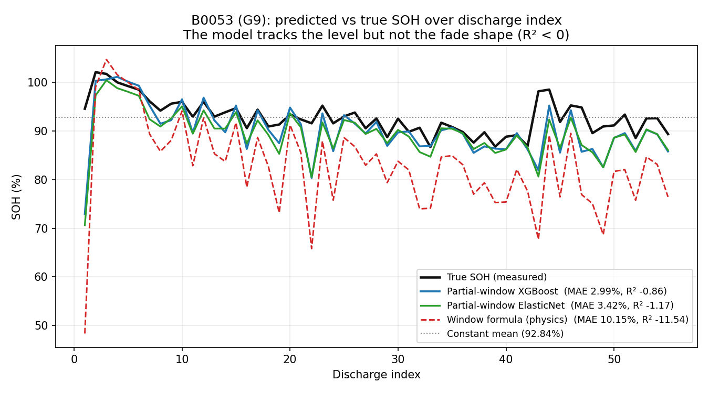

# Results

The tables below are generated from the CSVs under `data/processed/` by `scripts/make_report.py` and cannot be edited by hand. They back the summary in the top-level `README.md`; the full interpretation of every number is here.

## Key Results

Every number in the regions below is a `{{id}}` placeholder rendered by `scripts/make_report.py` from `data/processed/report_numbers.json`, which the same script writes from the CSVs under `data/processed/`. `scripts/check_numbers.py` re-renders these regions from that JSON, so a hand-typed number fails verification.

### SOH Prediction (State of Health)

<!-- make_report:results -->
#### Cross-condition transfer (leave-one-group-out, partial window only)

**On the partial-discharge task the model does not transfer across conditions when it is trained on raw window features.** A BMS that only watches the partial-discharge window never sees the full discharge, so this is the honest version of the SOH question: predict SOH from the window alone.
With the full feature set, leave-one-cell-out within G1 the same ElasticNet model reaches 1.81% MAE; held out across conditions on raw window features it climbs to as much as 42.66%. The table below is that failure, measured, not a model claim.

| Held-out group | Cells | Cycles | ElasticNet MAE (%) | XGBoost MAE (%) |
|---|---|---|---|---|
| G1 | 4 | 636 | 42.66 | 14.96 |
| G3 | 4 | 160 | 16.29 | 18.75 |
| B0053 (G9) | 1 | 55 | 7.47 | 6.69 |

**Cell-relative window features recover the transfer, and the model then beats the window formula on the held-out condition.** Because the groups differ in ambient temperature (G1 24 °C, G3 43 °C, G9 4 °C) and current (G1 2 A, G3 4 A, G9 2 A), the raw levels do not line up. Dividing each window quantity by the cell's own first-five-discharge median and by its current puts every cell on the same scale and makes the ElasticNet transfer to a condition it has never seen. The window formula — the window's amp-hours over that same per-cell median — is the best a BMS can do from the window alone, so it is scored on exactly the held-out cells for comparison.

| Held-out group | Cells | Cycles | window formula MAE (%) | raw ElasticNet MAE (%) | cell-relative ElasticNet MAE (%) | cell-relative XGBoost MAE (%) |
|---|---|---|---|---|---|---|
| G1 | 4 | 636 | 10.92 | 42.66 | 4.58 | 9.38 |
| G3 | 4 | 160 | 2.13 | 16.29 | 1.60 | 1.07 |
| B0053 (G9) | 1 | 55 | 10.15 | 7.47 | 3.42 | 2.99 |

B0053 is the only G9 cell the audit keeps, so its row is that cell alone, never averaged into a group. Reading it: the cell-relative ElasticNet error on B0053 is 3.42% against the window formula's 10.15%, and the cell-relative XGBoost error is 2.99% — both beat the formula on a condition the model has never seen. On the two multi-cell groups the model also beats it cell-by-cell (G1 ElasticNet 4.58% versus 10.92%, G3 ElasticNet 1.60% versus 2.13%), though XGBoost is weaker on G1. The cell-by-cell partial-discharge section below reports the same task with leave-one-cell-out validation.


#### Partial-discharge SOH, cell by cell (window only)

The same task, scored one held-out cell at a time: leave-one-cell-out within G1 and within G3, then train on every G1 and G3 cell and test on B0053, a condition the model has never seen. The window formula is scored on exactly the held-out rows.

| Protocol | Held-out cell | Cycles | window formula MAE (%) | ElasticNet MAE (%) | XGBoost MAE (%) |
|---|---|---|---|---|---|
| leave-one-cell-out: G1 | B0005 | 168 | 8.91 | 1.34 | 1.06 |
| leave-one-cell-out: G1 | B0006 | 168 | 18.82 | 2.51 | 3.31 |
| leave-one-cell-out: G1 | B0007 | 168 | 6.29 | 1.17 | 0.88 |
| leave-one-cell-out: G1 | B0018 | 132 | 9.32 | 1.70 | 0.89 |
| **leave-one-cell-out: G1 — mean** | — | — | 10.83 | 1.68 | 1.53 |
| leave-one-cell-out: G3 | B0029 | 40 | 1.94 | 0.74 | 0.69 |
| leave-one-cell-out: G3 | B0030 | 40 | 1.11 | 1.43 | 1.29 |
| leave-one-cell-out: G3 | B0031 | 40 | 1.06 | 0.80 | 0.65 |
| leave-one-cell-out: G3 | B0032 | 40 | 4.40 | 4.15 | 1.64 |
| **leave-one-cell-out: G3 — mean** | — | — | 2.13 | 1.78 | 1.07 |
| Train G1+G3, test B0053 | B0053 | 55 | 10.15 | 3.42 | 2.99 |
| **Train G1+G3, test B0053 — mean** | — | — | 10.15 | 3.42 | 2.99 |

The row the deployable estimator is held to is the B0005 leave-one-cell-out one — 1.34% ElasticNet and 1.06% XGBoost — on a cell its training set never contained. That is the accuracy number for B0005. The in-sample counterpart the backend regression test reads only shows the estimator runs the same deterministic pipeline at that cell; it is a determinism check, not accuracy, and is not quoted here.

#### B0053: one cell, and an R² that says the shape is not learnt



B0053 is reported as the single cell it is, plotted predicted against true SOH over discharge index rather than only averaged into a metric. The partial-window XGBoost is close in level — MAE 2.99% — but its R² is -0.86, below even a constant mean, so it does not follow the fade: the low error comes from B0053's narrow SOH range, not from tracking its trajectory. That is the honest reading of the transfer — the cell-relative features carry the operating condition's level to a cell the model has never seen, not its degradation path.

#### Random-load transfer (cells the model was never trained on)

The random-load cells the audit keeps — B0039 from G5 and B0042–B0044 from G6 — reach the retirement threshold and pass the keep filter, but they are left out of training because their load and temperature change across the record. Feeding them to the shipped window model, which saw only the nine constant-current cells, with the same cell-relative features, next to the window formula on exactly the same discharges:

| Held-out cell | Group | Cycles | window formula MAE (%) | window formula R² | cell-relative XGBoost MAE (%) | cell-relative XGBoost R² |
|---|---|---|---|---|---|---|
| B0039 | G5 | 35 | 7.71 | -7.665 | 3.54 | -0.093 |
| B0042 | G6 | 65 | 9.88 | -2.665 | 1.82 | 0.893 |
| B0043 | G6 | 65 | 8.50 | -1.821 | 1.74 | 0.882 |
| B0044 | G6 | 65 | 6.18 | -0.446 | 2.13 | 0.778 |
| **Mean** | — | 230 | 8.07 | -3.149 | 2.31 | 0.615 |

The model does not fail on these cells. It beats the window formula on 4 of 4, with mean MAE 2.31% against the formula's 8.07%, and it tracks the fade (R² above zero) on 3 of 4. The exception is B0039 (G5): its R² is -0.093, below a constant mean, so there the model reads the level, not the fade shape — the same caveat B0053 carries above. The exclusion is therefore a comparability choice, not a transfer failure.


#### Noise and shorter-window robustness (held-out cells)

The partial-window model is trained on the clean 4.0-3.4 V window; here the *held-out* cell's inputs are perturbed while its training siblings stay clean, so this measures inference-time robustness. Each level is scored by leave-one-cell-out within G1 and G3 and by training on G1+G3 and testing B0053, then pooled over all nine held-out cells. A pooled MAE under 3% is treated as still working.

| Perturbation | Voltage noise (mV) | Current noise (%) | Window (V) | Held-out XGBoost MAE (%) | ElasticNet MAE (%) | window formula MAE (%) |
|---|---|---|---|---|---|---|
| Clean baseline | — | — | 4.0–3.4 | 1.57 | 1.81 | 9.22 |
| Voltage noise | 5 mV | — | 4.0–3.4 | 1.65 | 2.76 | 9.86 |
| Voltage noise | 10 mV | — | 4.0–3.4 | 1.98 | 2.78 | 10.28 |
| Voltage noise | 20 mV | — | 4.0–3.4 | 2.53 | 4.34 | 11.34 |
| Current noise | — | 1% | 4.0–3.4 | 1.57 | 1.81 | 9.21 |
| Current noise | — | 2% | 4.0–3.4 | 1.57 | 1.81 | 9.16 |
| Current noise | — | 5% | 4.0–3.4 | 1.56 | 1.81 | 9.25 |
| Shorter window | — | — | 3.9–3.5 | 4.99 | 4.43 | 10.96 |
| Shorter window | — | — | 3.8–3.6 | 6.47 | 8.76 | 10.92 |

**Held-out XGBoost MAE (%) by protocol**

| Protocol | Clean | 3.9–3.5 V | 3.8–3.6 V |
|---|---|---|---|
| G1 leave-one-cell-out | 1.57 | 6.07 | 7.64 |
| G3 leave-one-cell-out | 1.07 | 1.20 | 2.85 |
| G1+G3 → B0053 | 2.99 | 3.44 | 3.56 |

**Verdict.** The model tolerates sensor noise: pooled held-out MAE stays under 3% up to the largest voltage noise tried, 20 mV, and the largest current noise tried, 5%. Current noise barely moves the features at all — the window capacity is an integral of the current, so zero-mean multiplicative noise averages out, and the window voltage features do not see the current. Voltage noise does move them, mostly through the dQ/dV peak height, but even at 20 mV the pooled MAE is 2.53%.

It does **not** survive a shorter window *at inference*: feeding a narrower band to the model trained on 4.0–3.4 V moves its inputs off the distribution it learnt, and both narrower bands push the pooled held-out MAE above the budget — 4.99% over 3.9–3.5 V and 6.47% over 3.8–3.6 V — but this is a mismatch test, not a verdict on shorter windows. The cost lands on G1: its leave-one-cell-out MAE rises from the clean value to well above the budget on both bands, while G3 and B0053 stay near it. Whether a *model trained on* the shorter band works is a separate question, answered in the next subsection.


#### A model trained on its own window (held-out cells)

The robustness test above feeds a shorter band to the *shipped* model, which is trained on the 4.0–3.4 V feature distribution, so its failure is a mismatch. This test removes the mismatch: each band gets its own model, with its cell-relative features recomputed from the raw traces over that band only, and is scored the same way the present model is — leave-one-cell-out within G1 and within G3, then train on every G1 and G3 cell and test B0053 and the four random-load cells. All thirteen scored cells are held out of their own training set, and a band's training rows never enter another band's model. The model is XGBoost, the shipped family; ElasticNet is not the model and appears only in the appendix. A band is judged on three numbers at once, not on the pool alone — the pooled held-out MAE, the MAE on the four random-load cells alone, and the worst single held-out cell — and passes only when all three are under 3%.

| Window (V) | Span (V) | Pooled MAE (%) | Random-load MAE (%) | Worst single-cell MAE (%) | Under 3% on all three |
|---|---|---|---|---|---|
| 4.0–3.4 | 0.60 | 1.70 | 2.18 | 3.64 | no |
| 3.9–3.5 | 0.40 | 1.76 | 2.83 | 3.80 | no |
| 3.8–3.6 | 0.20 | 1.94 | 3.33 | 5.50 | no |
| 4.1–3.7 | 0.40 | 2.46 | 5.27 | 8.83 | no |
| 3.7–3.4 | 0.30 | 2.43 | 3.23 | 6.86 | no |

**Verdict.** No window tried passes all three tests with a model of its own. All 5 bands hold the pooled held-out MAE under 3% (5 of 5), and 2 of 5 also hold the random-load mean, but none keeps every single cell under budget (0 of 5). The shipped 4.0–3.4 V band is 1.70% pooled and 2.18% on the random-load cells, yet its worst cell is 3.64%, which is also the smallest worst-cell error of any band (3.64%). The reading that a shorter window works once the model is trained on it survives on the pooled and random-load numbers but not on the worst cell, so no band — the shipped band included — is settled once every single cell has to stay under 3%.


##### Appendix: ElasticNet and the window formula

ElasticNet is not the model — XGBoost is, and the verdict above is read from XGBoost alone. ElasticNet is carried only as a comparison, and it is the fragile one here: its inputs are unbounded ratios, and a random-load cell whose opening discharges barely cross the band (B0039) gives a tiny five-discharge baseline, so its later window ratios run orders of magnitude past the training range. A linear fit extrapolates that to implausible SOH while the tree model stays bounded. A cell whose ElasticNet or window-formula score leaves the sane range (R2 below -1000 or MAE above 100%) is written as *unstable* rather than as a raw number: at that magnitude the digits are floating-point noise, not a measurement, and writing them would make the file change from one machine to the next.

| Window (V) | ElasticNet MAE (%) | Random-load ElasticNet MAE (%) | window formula MAE (%) |
|---|---|---|---|
| 4.0–3.4 | 1.81 | unstable | 9.22 |
| 3.9–3.5 | 1.02 | unstable | 10.96 |
| 3.8–3.6 | 1.34 | 7.78 | 10.92 |
| 4.1–3.7 | 1.52 | 11.16 | 11.66 |
| 3.7–3.4 | 1.37 | unstable | 8.74 |

#### Reference-window sensitivity (partial-discharge)

The cell-relative features need a baseline from the cell's own first `n` discharges; a new cell may have very few. Rebuilding the baseline for one, two, three and five opening discharges and re-running the task:


**Leave-one-cell-out (G1+G3)**

| Discharges used as baseline | window formula MAE (%) | ElasticNet MAE (%) | XGBoost MAE (%) |
|---|---|---|---|
| 1 | 15.16 | 1.46 | 1.82 |
| 2 | 9.14 | 1.31 | 1.47 |
| 3 | 6.59 | 1.60 | 1.26 |
| 5 | 6.48 | 1.73 | 1.30 |

**Train G1+G3, test B0053**

| Discharges used as baseline | window formula MAE (%) | ElasticNet MAE (%) | XGBoost MAE (%) |
|---|---|---|---|
| 1 | 78.57 | 22.09 | 4.01 |
| 2 | 20.98 | 7.16 | 4.05 |
| 3 | 9.50 | 2.83 | 2.74 |
| 5 | 10.15 | 3.42 | 2.99 |

Inside a group the picture is mixed: the plain window formula is sensitive to the baseline length, while the learned models stay flat because the held-out cell is trained on siblings at the same condition. The cross-condition transfer to B0053 is where the baseline length matters for the model too: one or two opening discharges set the scale too coarsely and the error spikes, and from three discharges it settles near its floor. The practical reading: give a new cell a few discharges before trusting its cell-relative SOH.


#### Offline SOH benchmark (full feature set)

This benchmark is deliberately offline: it uses every production feature, including full-discharge signals such as duration and resistance that a BMS only observes once the discharge has finished. It is a model-to-model reference; the online task, and the only place a model is compared against a physics formula, is the partial-discharge section above. The full-discharge Coulomb row is the formula that would be used when a complete discharge is available.

| Method | Validation | Mean MAE (%) | Mean R² |
|---|---|---|---|
| Coulomb formula | leave-one-cell-out (G1) | 0.73 | 0.993 |
| ElasticNet (default) | leave-one-cell-out (G1) | 1.81 | 0.948 |
| Ridge (default) | leave-one-cell-out (G1) | 2.70 | 0.908 |
| RandomForest (default) | leave-one-cell-out (G1) | 2.52 | 0.899 |
| XGBoost (fixed params) | leave-one-cell-out (G1) | 2.74 | 0.894 |
| XGBoost (nested tuning) | nested leave-one-cell-out (G1) | 2.65 | 0.900 |
| Constant global mean | leave-one-cell-out (G1) | 9.28 | — |

#### Per-cell SOH error (XGBoost, nested)

| Held-out cell | MAE (%) | RMSE (%) | R² |
|---|---|---|---|
| B0005 | 1.47 | 1.76 | 0.971 |
| B0006 | 5.62 | 6.23 | 0.751 |
| B0007 | 1.54 | 1.82 | 0.954 |
| B0018 | 1.96 | 2.30 | 0.925 |

#### Full- versus partial-discharge formulas (no model)

When the full discharge is available, SOH is read directly from the measured capacity by Coulomb counting and no model is used; the error is the formula's, not a prediction's. When only the window is available the same kind of formula is much weaker, which is exactly why the partial-discharge models above exist.

| Method | Held-out cell | MAE (%) |
|---|---|---|
| Full-discharge formula | B0005 | 0.17 |
| Full-discharge formula | B0006 | 0.53 |
| Full-discharge formula | B0007 | 0.28 |
| Full-discharge formula | B0018 | 0.18 |
| Full-discharge formula | mean (G1) | 0.29 |
| Partial-window formula | B0005 | 8.91 |
| Partial-window formula | B0006 | 18.82 |
| Partial-window formula | B0007 | 6.29 |
| Partial-window formula | B0018 | 9.32 |
| Partial-window formula | mean (G1) | 10.83 |

#### Feature-set ablation (XGBoost/ElasticNet, leave-one-cell-out on G1)

| Feature set | Features | ElasticNet MAE (%) | XGBoost MAE (%) |
|---|---|---|---|
| A — all production features | 39 | 1.81 | 2.74 |
| B — A without window features | 34 | 3.85 | 3.06 |
| C — window + temperature + current | 13 | 1.68 | 2.19 |
| D — window features only | 5 | 1.86 | 2.57 |
<!-- make_report:results:end -->

<!-- make_report:charge -->
#### Can constant-current charging estimate SOH?

The discharge loader keeps discharge cycles only: `load_data.iter_discharge_traces` skips every cycle whose type is not a discharge, so the ML dataset, the window model and every document see discharges alone. Charge segments are read by a separate stage (`src/charge_soh.py`) that leaves the discharge path untouched. It rebuilds the same window quantities — time, capacity, mean voltage and the dQ/dV peak — over the 3.8–4.0 V constant-current charge band, pairs each charge with the discharge that follows it (which carries the production-rule SOH target), and scores the same held-out protocol: leave-one-cell-out within G1 and G3, then train on G1+G3 and test B0053 and the four random-load cells. The upper bound is 4.0 V rather than the 4.1 V one might first try because several charges on B0053, B0032 and B0039 top out near 4.08 V, so a 4.1 V band is not crossed every cycle and would drop those cells; every kept cell crosses 3.8–4.0 V.

| Protocol | Model | Charge-window MAE (%) | Discharge-window MAE (%) | Difference (%) |
|---|---|---|---|---|
| Leave-one-cell-out G1 | XGBoost | 3.23 | 1.57 | 1.66 |
| Leave-one-cell-out G1 | ElasticNet | 3.09 | 1.68 | 1.41 |
| Leave-one-cell-out G3 | XGBoost | 1.35 | 1.07 | 0.28 |
| Leave-one-cell-out G3 | ElasticNet | 1.41 | 1.78 | -0.37 |
| G1+G3 → B0053 | XGBoost | 12.72 | 2.99 | 9.73 |
| G1+G3 → B0053 | ElasticNet | 9.17 | 3.42 | 5.74 |
| G1+G3 → random-load | XGBoost | 8.04 | 2.18 | 5.86 |
| G1+G3 → random-load | ElasticNet | 9.81 | unstable | unstable |

**Verdict.** Charging carries a real SOH signal — on the G3 cells a model over the charge window matches the discharge model, 1.35% against 1.07% — but it transfers worse everywhere else and is not a replacement for the discharge window. On the warm G1 cells it is 3.23% (discharge 1.57%), on the cold G9 cell B0053, a condition the charge model never saw, it is 12.72% (discharge 2.99%), and on the random-load cells it is 8.04% (discharge 2.18%). So the answer is: partly, on the cells and conditions the charge model is trained on, but the charge window is a weaker held-out estimator than the discharge window, and only the G3 protocol stays under the 3% budget.
<!-- make_report:charge:end -->

### RUL Prediction (Remaining Useful Life, Indicative)

<!-- make_report:rul -->
> **Indicative, not a forecast.** Every remaining-life number here is an estimate from a handful of reference trajectories under one load. It says where a cell sits on the average ageing path, not what will happen to that particular cell.

| Held-out cell | EOL discharge | Trajectory MAE | Fleet-lifetime baseline MAE | Reference-spread coverage | Mean reference-spread width |
|---|---|---|---|---|---|
| B0005 | 107 | 7.1 | 24.8 | 93.8% | 25.8 |
| B0006 | 61 | 51.1 | 46.0 | 0.0% | 25.5 |
| B0007 | 125 | 17.5 | 37.5 | 17.5% | 14.6 |
| B0018 | 78 | 6.5 | 29.0 | 82.1% | 20.3 |
| **Mean** | — | 20.5 | 34.3 | 48.3% | 21.6 |

#### Both methods, side by side on every held-out cell

The matcher was also scored against a fade-rate extrapolation: a straight line through the first 20 measured SOH values of the cell, extended to the retirement threshold. Both are leave-one-cell-out and use the same held-out discharges, so the columns are comparable. The last numeric column is the mean absolute gap between the two methods over those discharges.

| Held-out cell | Trajectory MAE | Early-fade extrapolation MAE | Method disagreement | Fleet-lifetime baseline MAE |
|---|---|---|---|---|
| B0005 | 7.1 | 76.9 | 81.4 | 24.8 |
| B0006 | 51.1 | 8.0 | 59.1 | 46.0 |
| B0007 | 17.5 | 90.8 | 107.1 | 37.5 |
| B0018 | 6.5 | 8.2 | 7.5 | 29.0 |
| **Mean** | 20.5 | 46.0 | 63.8 | 34.3 |

No method is chosen per cell, and no cell is scored with the method that happens to win it: that would be reading the answer off the test set. Instead both methods are shown on every held-out cell and their disagreement is reported as the uncertainty. It is large — 63.8 discharges on the mean, and 107.1 on B0007 — because a line that overshoots a late knee and a matcher that follows reference curves can disagree by an entire lifetime. That width, not a point estimate, is the honest statement about RUL on four cells, and it is why the whole task is labelled indicative.

#### Calibrating a real 10th-to-90th band

The reference-spread band above is a quantile of the reference cells' remaining life, not a calibrated error band. The honest version calibrates the band on the other cells and measures it on a cell it never saw: for each held-out cell the offsets are the 10th and 90th percentile of the (truth - estimate) residuals pooled from the other three cells.

| Held-out cell | Max points | Calibration cells | Lower offset | Upper offset | Coverage |
|---|---|---|---|---|---|
| B0005 | 96 | 3 | -51.0 | 27.0 | 100.0% |
| B0006 | 50 | 3 | -6.0 | 25.0 | 0.0% |
| B0007 | 114 | 3 | -52.0 | 10.0 | 28.1% |
| B0018 | 67 | 3 | -50.0 | 25.0 | 100.0% |
| **Mean** | — | — | — | — | 57.0% |

A 10th-to-90th band should cover four discharges in five, and this one misses by a wide margin and swings from 0.0% to 100.0% across cells. It is not fixable here: only three cells calibrate any held-out band, and one cell's residuals are correlated across its discharges, so the effective calibration sample is closer to three than to the number of points. A trustworthy calibrated band needs more cells than the four in G1; the reference spread remains the only band this dataset supports.

#### More cells that reach 80%? Yes, in the random-load groups

RUL needs a cell that actually reaches the retirement threshold, so the groups the model leaves out were checked against the same SOH rule rather than assumed dead. The NASA random-load groups G5 (B0038-B0040) and G6 (B0041-B0044) were run through it: 7 cells checked, 5 reach 80%, and 4 of those also pass the same ceiling/rise keep filter (B0039, B0042, B0043, B0044). So the claim that only the four G1 cells reach 80% is false in general: four more cells do. They are still not added to the constant-current SOH/RUL training set, because their load and temperature change across the record, so their features are not comparable at a single operating condition; but they are not left out because the model fails on them — the shipped partial-window SOH model transfers to all of them and beats the window formula (see the random-load transfer table under *Key Results*), so the exclusion is a comparability choice. B0041 reaches 80% too but is excluded, and its reference shows why: its opening 10 recorded discharges carry a median 0.056 Ah at a mean 0.27 A — about a quarter of the group's own load — with the terminal voltage falling by only 0.049 V, against 0.89 Ah once the cell discharges normally later in life. Those opening runs are a measurement failure, not a low-capacity cell, but they are the majority of the record, so the rule that keeps only discharges above half the cell's median normalises against them and keeps them; the resulting 0.056 Ah reference is an artifact, its SOH rises above the ceiling and the cell is excluded — which is why no cell the pipeline trusts has a reference under half the median of its later valid discharges.

#### RUL on the random-load cells, kept separate from G1

The four random-load cells that reach retirement are labelled by the same rule as G1 — the first valid discharge below 80% of the cell's first-five-median capacity. B0039 is the only usable G5 cell, so it has no in-group siblings and is labelled but not scored; the three G6 cells (B0042, B0043, B0044) are scored three ways. Both methods and the fleet-lifetime baseline are reported for every held-out cell.

| Cell | Group | EOL discharge | Discharges |
|---|---|---|---|
| B0039 | G5 | 34 | 35 |
| B0042 | G6 | 60 | 65 |
| B0043 | G6 | 60 | 65 |
| B0044 | G6 | 57 | 65 |

The matcher is driven by the held-out cell's own measured SOH, which a full-discharge BMS observes, because the cycle-level SOH model is defined on constant-current features and is not valid across these loads; the fade-rate extrapolation reads only the held-out cell's own opening 20 measured discharges, so its number is the same in every protocol.

**(a) leave-one-cell-out inside G6**

| Held-out cell | Trajectory MAE | Early-fade extrapolation MAE | Fleet-lifetime baseline MAE |
|---|---|---|---|
| B0042 | 8.7 | 24.6 | 1.0 |
| B0043 | 4.3 | 5.9 | 1.0 |
| B0044 | 3.2 | 9.5 | 3.0 |
| **Mean** | 5.4 | 13.4 | 1.7 |

Neither method beats the fleet-lifetime baseline on this group: across the 3 held-out cells the baseline is at or below both methods.

**(b) train the matcher on G1, test on each G6 cell**

| Held-out cell | Trajectory MAE | Early-fade extrapolation MAE | Fleet-lifetime baseline MAE |
|---|---|---|---|
| B0042 | 22.9 | 24.6 | 32.5 |
| B0043 | 20.8 | 5.9 | 32.5 |
| B0044 | 18.0 | 9.5 | 35.5 |
| **Mean** | 20.6 | 13.4 | 33.5 |

The matcher beats the baseline on 3 of 3 cells and the fade-rate extrapolation on 3 of 3.

**(c) train the matcher on G6, test on each G1 cell**

| Held-out cell | Trajectory MAE | Early-fade extrapolation MAE | Fleet-lifetime baseline MAE |
|---|---|---|---|
| B0005 | 15.3 | 76.9 | 35.7 |
| B0006 | 4.6 | 8.0 | 1.0 |
| B0007 | 28.4 | 90.8 | 46.8 |
| B0018 | 7.5 | 8.2 | 15.7 |
| **Mean** | 13.9 | 46.0 | 24.8 |

The matcher beats the baseline on 3 of 4 cells and the fade-rate extrapolation on 1 of 4.

Only protocol (b) mixes the groups, and it is the one where both methods clear the baseline on every G6 cell: a G6 cell is watched by G1 references that sit at a different load, but the two G6 cells left in (a) retire at almost the same discharge, so there the baseline is simply a very good guess.

#### One decision: RUL ships as a range, not a point estimate

Neither method wins everywhere. Leave-one-cell-out inside G6, the fleet-lifetime average is the best estimate on all 3 cells — MAE 1.0–3.0 discharges — against the matcher's 3.2–8.7 and the early-fade extrapolation's 5.9–24.6. Trained on G6 and tested across groups on each G1 cell, the matcher beats the fleet-lifetime average on 3 of 4 cells; B0006 is the exception, because it fades faster than any reference trajectory. Since the winner depends on the cell and the reference group, no single method is shipped: every discharge carries an indicative range, the minimum to the maximum of the matcher, the early-fade extrapolation and the fleet-lifetime average at that discharge (mean width 91.2 discharges on the held-out G1 cells).

#### Does a longer fade-rate window help?

The fade-rate extrapolation is a single straight line through a cell's first 20 measured discharges, so its answer is fixed entirely by that window's slope. Refitting it at 30 and 40 discharges and re-scoring all 8 labelled cells gives the table below.

| Cell | 20-discharge fit | 30-discharge fit | 40-discharge fit |
|---|---|---|---|
| B0005 | 76.9 | 301.0 | 242.6 |
| B0006 | 8.0 | 13.9 | 11.5 |
| B0007 | 90.8 | 316.8 | 179.7 |
| B0018 | 8.2 | 7.6 | 10.4 |
| B0039 | 691.7 | 103.0 | 25.1 |
| B0042 | 24.6 | 38.3 | 31.9 |
| B0043 | 5.9 | 3.2 | 2.8 |
| B0044 | 9.5 | 4.1 | 2.7 |
| **Mean** | 114.5 | 98.5 | 63.3 |
| **Median** | 17.1 | 26.1 | 18.3 |

As an average the longer window looks better — mean MAE falls from 114.5 to 63.3 discharges — but that average is one cell. B0039 barely fades over its first discharges and then knees late, so its line at the default window lands 692 discharges past its real end of life; by 40 discharges the fit finally sees the knee and its error drops to 25.1. Everywhere else the longer window hurts: the median does not fall (17.1 to 18.3) and 5 of the 8 cells get worse, the two flat-opening G1 cells collapsing as the line flattens further — B0005 from 76.9 to 242.6 and B0007 from 90.8 to 179.7. The longer window is therefore not kept; the default stays at 20 discharges.

The figure shows what fails. B0005 and B0007 fade all but flatly over those 20 discharges, so the fitted line is far too shallow: it reaches 80% at discharge 184 for B0005 and 216 for B0007, while the cells actually retire at 107 and 125. The trajectory matcher never extrapolates that opening slope — it reads the cell's current level against reference curves — so it lands far closer on the same cells (B0005 7.1 against 76.9, B0007 17.5 against 90.8). The reverse holds on B0006, which fades from the first discharge and faster than any reference: there the matcher is the one that fails and the extrapolation is accurate.


<!-- make_report:rul:end -->

> **Unit:** All RUL targets and predictions are measured in **sequential discharges** (`discharge_index`), not raw interleaved cycle numbers.

> **The interval is a reference spread, not a calibrated band.** The `rul_p10`/`rul_p90` values are the 10th and 90th percentiles of the remaining-life estimates produced by the *reference cells* a curve is matched against, so they say how much the answer depends on which reference you match — nothing more. The column above reports the empirical coverage of that spread against the real remaining life: it is 48.3% on average, not the ~80% a "10th–90th" label would imply. B0006 is the worst case at 0.0%: it fades faster than every reference cell (0.309 %/discharge, the steepest of the four) and retires far sooner, so the matcher, reading its remaining life off reference curves that aged more slowly, over-predicts what is left and the true value lands below the low end of the spread at every point. That is a limitation of matching one cell against reference curves that retired later, and it is reported rather than hidden.

### Battery Degradation Characteristics

<!-- make_report:degradation -->
| Cell | EOL discharge | Fade (%/discharge) | Early fade (%/discharge) |
|---|---|---|---|
| B0005 | 107 | 0.214 | 0.058 |
| B0006 | 61 | 0.309 | 0.284 |
| B0007 | 125 | 0.188 | 0.067 |
| B0018 | 78 | 0.248 | 0.319 |
| B0029 | — | 0.281 | 0.281 |
| B0030 | — | 0.279 | 0.279 |
| B0031 | — | 0.176 | 0.176 |
| B0032 | — | 0.286 | 0.286 |
| B0053 | — | 0.125 | 0.267 |

#### Re-referencing the excluded cells

Every SOH above is measured against the median of the cell's first five valid discharges. A gentler re-reference was checked on the excluded cells: the median of discharges 3-8, and the beginning-of-life peak (the maximum of the first five). The SOH ceiling and the capacity-rise test are held fixed, so a cell is returned only when the reference, not the rule, was what excluded it.

| Excluded cell | Group | first five median soh_max | median 3-8 soh_max | BOL-peak soh_max | Returned? |
|---|---|---|---|---|---|
| B0033 | G4 | 146.3 | 128.2 | 142.6 | no |
| B0034 | G4 | 112.3 | 118.1 | 109.5 | no |
| B0036 | G4 | 135.7 | 136.1 | 135.4 | no |
| B0045 | G7 | 122.2 | 129.9 | 100.0 | yes (BOL peak) |
| B0046 | G7 | 115.0 | 118.0 | 100.0 | yes (BOL peak) |
| B0047 | G7 | 111.0 | 114.8 | 100.0 | yes (BOL peak) |
| B0048 | G7 | 110.6 | 113.8 | 100.0 | yes (BOL peak) |
| B0054 | G9 | 106.4 | 109.0 | 100.0 | no |
| B0055 | G9 | 105.0 | 109.3 | 100.0 | no |
| B0056 | G9 | 103.6 | 105.7 | 100.0 | no |

The gentler rule the check started from returns nothing: none of B0054, B0055 or B0056 comes back. Their capacity genuinely rises from the recorded first discharge, so the drift is in the data, not only in the reference; B0054 also stays above the ceiling. The four G7 cells return under the beginning-of-life peak alone, because their reading above the 105% ceiling was a high first cycle sitting above the early median rather than a real rise. No G4 cell returns under any rule: its capacity rises across the record by far more than a reference choice can explain.

The peak reference is reported and not adopted: applying it uniformly would rescale every kept cell's SOH, and a per-cell fallback would make the reference depend on the outcome it is tested against. The production reference is unchanged, so no kept cell's SOH and no reported number moves.
<!-- make_report:degradation:end -->

## SOH Definition

SOH is defined explicitly and in exactly one place, per cell:

```
SOH = capacity_ah / reference_capacity_ah x 100
```

`reference_capacity_ah` is the **median measured discharge
capacity of that cell's first five valid discharges**
(`src/data_cleaning.py`). A discharge is *valid* when its measured
capacity is greater than zero and at least half the cell's median
capacity; invalid rows (sensor dropouts, near-zero integrations)
are dropped before the reference is taken. The reference is
deliberately per-cell, not a chemistry-level nominal capacity,
because the NASA cells differ in their beginning-of-life capacity.
Every value in the `soh` column is computed from that one rule.

Consequences of this policy, stated plainly:

- SOH is approximately, not exactly, 100% at the reference
  discharges, because the reference is a median rather than a
  single cycle.
- SOH is only comparable *within* a cell, since two cells with
  different reference capacities share a scale but not an absolute
  reference.
- A cell that was already partly aged when first measured would
  read below 100% at that point.

The target is **not clipped**. `data/processed/cell_audit.csv`
records each cell's `soh_min` and `soh_max`; the audit reports
impossible values rather than hiding them. Cells whose ageing is
too limited to reach end-of-life are labelled `limited ageing, no
RUL` in the audit and kept out of the RUL reference set, rather
than being silently capped.

### Two SOH concepts, kept separate

**Mode A — reference / ground-truth SOH.** The label above,
computed from measured full-cycle capacity. This is the value the
model is trained to predict, and it is only available offline,
after a full discharge has been measured and integrated.

**Mode B — predictive / BMS SOH.** What a deployed battery
management system can actually compute at cycle time: a
prediction from the measured voltage, current, temperature and
duration features of the cycle. It uses **no** SOH, no capacity,
and no future cycle. This is the only mode the streaming service
serves.

Every predictive result in this document is Mode B. Mode A appears
only as the training target.

---

## Leakage Prevention

Target-derived columns are forbidden from reaching any estimator,
and the rule is enforced in code rather than by convention:

- `src/evaluation.py` defines `LEAKY_FEATURES`, the canonical
  list. `src/train_rul.py` keeps a narrower list because RUL is
  legitimately defined against the EOL cycle.
- `src/features.py` refuses to build an `X` matrix that contains
  any column in its `LEAKY_FEATURES`. This is the single choke
  point every training script passes through.
- `evaluation.assert_no_leakage()` is called inside
  `loco_evaluate()`, so a leaky column fails the run even if a
  caller bypasses `make_xy`.
- `tests/test_leakage.py` injects each leaky column in turn and
  asserts the pipeline raises.

The list currently covers: `soh`, `capacity_fade_pct`,
`soh_change_pct`, `capacity_change_ah`, `capacity_ah`,
`reference_capacity_ah`, `rul_cycles`, `rul_cycles_80`,
`eol_cycle_threshold`, `eol_cycle_observed`, `is_pre_eol`,
`soh_slope_pct_per_cycle`, `soh_slope_early_pct_per_cycle`.

The full-lifetime slopes are the clearest temporal leak: they are
fitted over the entire degradation curve, so at cycle *t* they
already encode cycles after *t*. They are never predictive inputs.

`src/data_quality.py` fails loudly on a missing or malformed
mandatory column, naming the file, the operation, the reason and
a suggested fix.

## Dataset

**Source:** NASA Prognostics Center of Excellence — Battery Dataset

The raw dataset spans **19 cells** across several operating
conditions. `src/data_cleaning.py` audits every cell and keeps the
ones whose measured capacity trace is usable; the audit and its
decision for each cell are in `data/processed/cell_audit.csv`.
Cells that do not reach end of life are labelled `limited ageing, no
RUL` and are kept for SOH only. Cells whose recomputed SOH rises above
the ceiling or whose capacity rises across the record are excluded
from every downstream table, model and database view. The excluded
cells are listed in the degradation section, together with the
re-reference check showing that the exclusion is not an artifact of
the reference window.

<!-- make_report:dataset -->
| Cell | Group | Discharges | Initial SOH (%) | Final SOH (%) | EOL discharge |
|---|---|---|---|---|---|
| B0005 | G1 | 168 | 101.15 | 72.20 | 107 |
| B0006 | G1 | 168 | 101.09 | 58.89 | 61 |
| B0007 | G1 | 168 | 100.55 | 76.17 | 125 |
| B0018 | G1 | 132 | 100.84 | 72.90 | 78 |
| B0029 | G3 | 40 | 93.49 | 88.78 | — |
| B0030 | G3 | 40 | 94.54 | 89.21 | — |
| B0031 | G3 | 40 | 92.37 | 92.40 | — |
| B0032 | G3 | 40 | 91.39 | 87.69 | — |
| B0053 | G9 | 55 | 94.57 | 89.36 | — |
| **Kept total** | 3 groups | 851 | — | — | — |
<!-- make_report:dataset:end -->

The model input set is the production feature list
(`src/features.py`) minus `ambient_temperature`, which is constant
within a group and dropped automatically by
`drop_constant_features` on the training split only. The
target-derived columns (`capacity_change_ah`, `soh_change_pct`) are
not inputs at all — see *Leakage Prevention* above.

`resistance_proxy_ohm` is named a **proxy** deliberately. It is
voltage range over current range, not a measured internal
resistance, and the project does not treat it as one.


## Model Details

### Evaluation Protocol

All models use **leave-one-cell-out (LOCO)** cross-validation: one cell is held out entirely, the model trains on the remaining cells of the same group, and predictions are made on a cell the model has never seen. This is the hardest available protocol because degradation curves differ between cells of the same chemistry. The **deployable, online** SOH task is the **partial-discharge task** — the 4.0–3.4 V window alone — and that is what the cross-condition and partial-discharge tables score, with the window formula as the physics comparator. A wider benchmark on the full feature set (which includes signals available only after a complete discharge) appears further down and is kept only for model-to-model comparison; it is not comparable to the full-discharge Coulomb formula, which sees the whole cycle. Cross-condition generalisation is measured separately with leave-one-group-out over the surviving groups. That measurement is the first table under *Key Results* and it is deliberately the first thing on the page: on raw window features the model does **not** transfer across conditions; per-cell baseline-relative window features fix the transfer, after which the model beats the **window formula** — the best a BMS can compute from the window alone — on the held-out condition.

### SOH Model

- **Algorithm:** XGBoost with `RandomizedSearchCV` (20 iterations, nested LOCO)
- **Best parameters:** `max_depth=2`, `learning_rate=0.01`, `n_estimators=800`, `subsample=0.7`, `reg_alpha=0.1`, `reg_lambda=2.0`
- **Pipeline:** `SimpleImputer(median)` → `XGBRegressor`

### RUL Model

- **Challenge:** With few cells, the model has very few examples of full degradation trajectories. RUL is dominated by the held-out cell's own future behavior.
- **Finding:** The trajectory-matching method beats the fleet-lifetime baseline on the mean but not on every cell; a plain cycle-level regression does not beat a constant. It also loses on the fast-fading B0006 to a simple early-fade extrapolation. Rather than pick the winning method per cell, the RUL table shows both methods on every held-out cell and reports their disagreement (63.8 discharges on the mean) as the indicative uncertainty. The degradation rate analysis provides per-cell fade rates, and the trajectory method provides the remaining-life estimate. See the RUL table for the current numbers.
